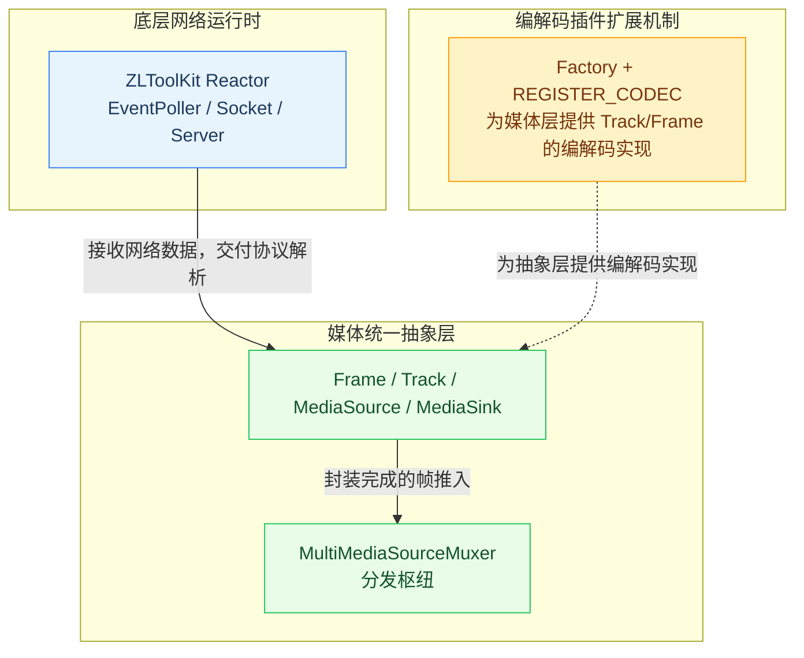
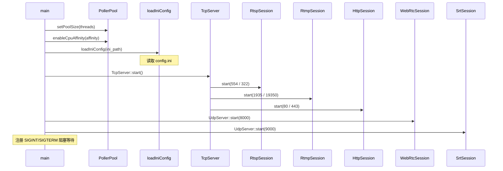

# 开篇：ZLMediaKit 能力全景与源码结构总览

> 专栏第 1 篇，阅读建议：本地 Clone ZLMediaKit 源码，对照源码阅读。

---

## 专栏说明

### 🎯 目标受众

本专栏面向已经会使用 ZLMediaKit、希望深入源码、做二次开发、排查相关源码问题的音视频后端工程师。

- ✅ 适合：初步熟悉和部署ZLM、调用 HTTP Hook/API；具备 C++ 基础；了解 Reactor 网络模型；了解音视频基础概念（Track、Frame、DTS/PTS）
- ❌ 不适合：希望学习快速部署、API 接口使用、FFmpeg 实操；完全没有 C++ 网络编程基础的读者。

### 本专栏解决什么，不解决什么

- **解决**：梳理 ZLM 核心架构、数据流模型、关键类协作逻辑；理解协议接入、媒体分发的内部实现；掌握二次开发的正确切入点；分析生产环境真实踩坑案例。
- **不解决**：API 手册；业务层对接方案；第三方依赖库（OpenSSL/libsrtp）原理详解。

---

## ZLM 二次开发的三大障碍

大量ZLM开发者在从"使用者"走向"源码二次开发者"的过程中，普遍会遇到三类障碍。这些障碍不完全来自官方文档缺失(https://github.com/ZLMediaKit/ZLMediaKit/wiki官方 Wiki 有大量部署与 API 使用文档及流程梳理文档，但缺少面向源码二次开发的深度解析)，**更多源于项目本身的复杂度：多协议共存、分层抽象、异步 Reactor 模型带来的认知成本**。

### 障碍 1：入口迷雾

**现象**：项目包含 400+ 源文件，对外只暴露业务 API，没有完整的数据流全景。当需要追踪一路推流从接入到多协议分发的全链路时，难以定位代码入口，容易在大量协议实现类中迷失。

> **根因**：ZLM 将协议层、媒体核心、网络 IO 做了解耦；对外暴露的是高层 API，内部数据流链路对使用者不可见。

### 障碍 2：抽象断层

**现象**：能看到 `MediaSource`、`MediaSink`、`MultiMediaSourceMuxer` 等核心类，但很难理清继承与组合关系；不理解为什么一路媒体源可以同时被 RTSP / RTMP / WebRTC / HLS 多协议订阅。

> **根因**：大量使用组合模式而非简单继承；协议实现子类繁多，公共抽象与协议具体实现分散在不同目录。

### 障碍 3：改源码恐惧

**现象**：有二次开发需求（增加钩子、修改切片逻辑、新增协议适配），但无法评估改动的影响范围，担心修改一处破坏整个推拉流链路，引入新的bug, 甚至破坏整个源码的可维护性。

> **根因**：异步回调模型、跨模块事件通知、对象生命周期复杂，局部改动容易产生连锁副作用。

### 问题的本质：一组核心矛盾

流媒体领域存在一组核心矛盾：**外部协议多种多样，但业务要求一路源能够同时对多协议客户端分发。**

针对该矛盾业界演化出两种架构思路：

1. **协议独立处理**：各协议模块独立完成解析与分发，码流在模块之间流转；
2. **媒体归一后分发**：所有外部协议接入后，先转换为框架内部协议无关的媒体对象，由统一枢纽完成广播分发。

ZLMediaKit 采用第二种思路，也是理解整个源码架构的钥匙。下一节展开两种思路的具体差异。

---

## 架构范式对比：多协议分发的两种实现思路

业界主流流媒体框架实现"一路推流，多协议分发"，大致分为两类思路：

**1. 协议独立式**：每个协议模块独立完成解封装、存储、分发；协议之间数据互通一般通过中间文件/中间流，模块耦合弱，但存在数据重复拷贝、时间戳对齐复杂等问题。

**2. 统一媒体抽象式（ZLMediaKit 采用）**：所有外部协议接入后，统一转换为内部与编解码无关的媒体抽象对象，交由中心分发枢纽广播；各拉流协议仅负责把统一帧再封装为对应协议格式。

ZLM 的核心设计命题可以一句话概括：**一次推流，多协议高效分发**。所有推流协议最终收敛到统一媒体抽象层；所有拉流协议从同一个分发枢纽订阅数据。协议只是前后的适配外壳，媒体处理逻辑集中。理解这一点，是读懂源码的前提。

---

## ZLMediaKit 三大核心设计模块

整个框架的能力建立在三套关键设计机制之上，模块之间存在明确的依赖层级：

1. **底层网络运行时（ZLToolKit Reactor）**：地基，提供异步 IO
2. **媒体统一抽象层**：核心骨架，实现一次推流多协议分发
3. **编解码插件扩展机制**：媒体层的可插拔组件



> 静态导出版本（IDE 不支持 Mermaid 时查看）：


### 模块 1：底层网络运行时（ZLToolKit）

> 核心组件：`EventPoller`、`Socket`、`TcpServer/UdpServer`、线程池

**职责**：提供跨平台异步网络能力，实现单端口多线程、连接迁移等高级特性，作为上层所有 Session 运行的底层运行时。

- **收益**：不依赖 boost/asio，可以深度定制流媒体场景网络行为；跨平台适配嵌入式、服务器。
- **约束**：需要维护一套独立网络库，开发维护成本高。

### 模块 2：媒体统一抽象层

> 核心组件：`Frame/Track`、`MediaSource/MediaSink`、`MultiMediaSourceMuxer`

**职责**：定义与传输协议、编码格式无关的媒体数据模型。推流侧把外部协议数据转换成内部 `Frame/Track`；拉流侧订阅帧数据再做协议封装；`MultiMediaSourceMuxer` 作为分发枢纽完成帧广播。

- **收益**：新增协议不需要重写媒体分发逻辑；一套分发逻辑服务全部协议。
- **约束**：所有协议接入都需要做协议 ↔ 内部抽象的转换层，增加协议接入开发量。

### 模块 3：编解码插件扩展机制

> 核心组件：`Factory`、`REGISTER_CODEC` 注册宏

**职责**：把各类编码格式解耦为插件，新增编码类型无需修改核心框架代码。

- **收益**：编解码格式可裁剪，适配嵌入式按需编译。
- **约束**：新增编码必须遵守固定插件注册规范。

### 模块依赖关系

模块 1（网络运行时）接收网络数据 → 交付协议层解析 → 模块 2（媒体抽象层）完成协议解封装转为内部媒体帧 → 模块 2 的分发枢纽广播 → 模块 3（编解码插件）为模块 2 提供各类编解码的解析/打包实现。

注：上层 RTMP、RTSP、WebRTC、SRT 等各类协议模块，是基于这三套设计实现的业务适配外壳，不归入核心架构抉择。

---

## 学习收益：从框架使用者到具备二次开发能力

在未深入源码之前，多数开发者停留在框架使用阶段：可以完成服务部署、配置调优、调用 HTTP API、对接业务系统，能解决配置、运维层面问题，但面对内核级需求会束手无策。

| 阶段 | 能力描述 |
|---|---|
| 使用阶段（专栏前置基础） | 能够部署运行 ZLMediaKit；熟悉 config.ini、WebHook、HTTP API；可以完成常规业务集成与运维排错。 |
| 完成本专栏学习后 | 1. **源码理解能力**：掌握内部数据流、核心对象生命周期、Reactor 异步模型，能够定位推拉流内核根因，排查普通文档无法解释的疑难问题。<br>2. **可控的二次开发能力（专栏核心目标）**：理解模块边界与对象约束，能够识别安全的扩展切入点；可以实现自定义业务钩子、修改 HLS/录制逻辑、增加业务统计埋点；能够评估代码改动的影响范围，规避异步回调、对象生命周期带来的链路破坏风险。<br>3. **协议扩展与社区参与能力**：读懂协议接入范式，具备实现简单自定义扩展的基础；能够看懂官方 Issue，输出有效问题定位，甚至参与社区 PR。 |

> 重要说明：本专栏目标不是通读项目全部源码。重点是建立架构认知，遇到业务需求时，知道**该改哪里、不该改哪里、改动会影响哪些链路**，安全地完成二次开发。

---

## 专栏路线图：从地基到实战的完整地图

为了系统走完从使用者到二次开发者的能力跃迁，全书约30 篇内容组织为 6 个递进模块。模块递进逻辑：先建立世界观和底层运行时，再吃透媒体核心抽象，之后逐个理解协议壳，最后落地二次开发实战。

```
世界观与架构  ──►  IO 基础设施  ──►  核心媒体抽象  ──►  协议栈  ──►  进阶调优  ──►  实战
 模块一(3篇)       模块二(7篇)     模块三(6篇)       模块四(8篇)  模块五(4篇)  模块六(2篇)
```

| 模块 | 定位 | 核心输出 |
|------|------|---------|
| 模块一 · 入门筑基 | 建立全景地图，能编译调试、能看懂 main.cpp | 不再迷路 |
| 模块二 · ZLToolKit 基石 | 搞懂 Reactor 事件循环 + 线程模型 + Socket 设计 | 能读懂所有异步代码 |
| 模块三 · 核心架构 | 吃透 MediaSource / MultiMediaSourceMuxer / 时间戳；理解 Frame/Track 以及编解码插件工厂注册机制 | 完整掌握数据流转、Track/Frame 对象生命周期与编码扩展原理 |
| 模块四 · 协议栈 | RTMP → RTSP → HTTP → WebRTC → GB28181 → SRT | 任选一种协议都能读懂 |
| 模块五 · 进阶调优 | 性能瓶颈、稳定性、录制回放、集群 | 生产环境不踩坑 |
| 模块六 · 二次开发 | GB28181 插件实战 + AI 钩子实战 | 能写自己的扩展 |

每篇按统一模板写：**读完能搞懂什么** → 关键文件清单 → 宏观流程（时序图/架构图）→ 核心数据结构 → **3-5 段代码精读（附"为什么选这段"）** → 设计取舍 → **2-3 个真实 GitHub Issues 踩坑** → 课后思考。

---

好，世界观和架构层说完了。现在让我们正式进入技术部分——用 `server/main.cpp` 这一个文件，看清 ZLM 到底是怎么"一次启动 10 种协议"的。

---

## 技术部分：从 main.cpp 看 ZLM 全景

### 文件定位

> 配套源码：https://github.com/ZLMediaKit/ZLMediaKit （以下路径均以仓库根目录为基准）

| 文件 | 作用 | 阅读优先级 |
|------|------|-----------|
| `server/main.cpp` | 服务端唯一入口，串起所有协议模块 | ⭐⭐⭐⭐⭐ |
| `CMakeLists.txt`（顶层） | 构建开关、模块依赖关系 | ⭐⭐⭐⭐ |
| `src/CMakeLists.txt` | 核心库 `zlmediakit` 的源码收集 | ⭐⭐⭐ |
| `src/Common/config.h` | 广播事件常量、配置加载接口 | ⭐⭐⭐ |
| `src/Common/MediaSource.h` | 流的生命周期基类 | ⭐⭐⭐ |
| `src/Common/MultiMediaSourceMuxer.h` | 分发枢纽 | ⭐⭐⭐ |
| `src/Extension/Factory.h` | 编码器插件注册工厂 | ⭐⭐⭐ |
| `3rdpart/ZLToolKit/src/Network/Server.h` | TCP/UDP 服务端模板基类 | ⭐⭐⭐ |

---

## 1. 宏观流程：从一个 main 函数看全协议启动

如果把 ZLMediaKit 比作一个大型商场，那么 `server/main.cpp` 就是这个商场的**开业典礼**——所有"店铺"（协议服务）都在这一刻挂牌营业。让我们跟着这个文件，看看 ZLM 到底同时开了哪些店：

### 1.1 main.cpp 启动时序



### 1.2 ZLM 能力全景表（从 main.cpp 端口直接提取）

| 协议 | 默认端口 | 传输层 | 源码目录 | 编译开关 |
|------|---------|--------|---------|---------|
| RTSP | 554 | TCP | `src/Rtsp/` | 始终开启 |
| RTSP(S) | 322 | TCP+SSL | `src/Rtsp/` | 需要 OpenSSL |
| RTMP | 1935 | TCP | `src/Rtmp/` | 始终开启 |
| RTMP(S) | 19350 | TCP+SSL | `src/Rtmp/` | 需要 OpenSSL |
| HTTP | 80 | TCP | `src/Http/` | 始终开启 |
| HTTPS | 443 | TCP+SSL | `src/Http/` | 需要 OpenSSL |
| WebRTC | 8000 (RTC) / 3000 (信令) / 3478 (ICE) | UDP+TCP | `webrtc/` | OpenSSL + SRTP |
| SRT | 9000 | UDP | `srt/` | `ENABLE_SRT` |
| GB28181 RTP | 10000 | UDP/TCP | `src/Rtp/` | `ENABLE_RTPPROXY` |
| Shell 调试 | 9000 | TCP | `src/Shell/` | 始终开启 |

这张表告诉你两件事：**ZLM 能同时跑多少种协议**（10 种以上），以及**每种协议在源码里的物理位置**——所有协议都有独立目录，互不纠缠，这是 ZLM 代码可读性高的核心原因。

---

## 2. 源码分层架构

顶层 CMakeLists.txt 是理解分层的最佳入口——它的 `add_subdirectory` 顺序就是 ZLM 的构建依赖层次：

```
add_subdirectory(3rdpart)   # 第 0 层：ZLToolKit（第三方，自研基础设施）
add_subdirectory(src)       # 第 1 层：zlmediakit（核心库，依赖 ZLToolKit）
add_subdirectory(ext-codec) # 第 1 层：编码器扩展（H264/H265/AAC/OPUS...）
add_subdirectory(srt)       # 第 2 层：SRT 协议（可选）
add_subdirectory(webrtc)    # 第 2 层：WebRTC 协议（可选）
add_subdirectory(api)       # 第 3 层：C API SDK
add_subdirectory(server)    # 第 4 层：MediaServer 可执行程序
add_subdirectory(tests)     # 独立：C++ 测试用例
```

### 分层架构图

```
┌──────────────────────────────────────────────────────────┐
│                    第 4 层：应用层                          │
│  server/  ← MediaServer 可执行程序（WebApi / WebHook /   │
│              配置加载 / 各协议 TcpServer::start() 全部在这里） │
├──────────────────────────────────────────────────────────┤
│                    第 3 层：API 封装层                      │
│  api/  ← C API SDK（mk_common / mk_media / mk_pusher /   │
│          mk_player / mk_thread ... 暴露给 C/C++/Go/其他语言） │
├──────────────────────────────────────────────────────────┤
│              第 2 层：可选协议模块                          │
│  webrtc/  ← WebRTC（ICE/DTLS/SRTP/SCTP/NACK/TWCC）        │
│  srt/     ← SRT（Caller/Listener/Rendezvous/重传）        │
├──────────────────────────────────────────────────────────┤
│              第 1 层：核心媒体处理层                        │
│  src/                                                    
│  ├── Common/    ← MediaSource / MediaSink / Stamp /      │
│  │                 MultiMediaSourceMuxer / PacketCache     │
│  ├── Extension/ ← Frame / Track / Factory（编码器插件注册）│
│  ├── Rtsp/      ← RTSP/RTP/RTCP（Session/MediaSourceImp）│
│  ├── Rtmp/      ← RTMP/FLV（Session/MediaSourceImp）     │
│  ├── Http/      ← HTTP(S)/WebSocket/HLS                  │
│  ├── Rtp/       ← RTP 解复用/编码/缓存（GB28181 / ES/PS/TS）│
│  ├── Record/    ← MP4 / HLS 录制，MP4Demuxer / MP4Muxer    │
│  ├── Player/    ← MediaPlayer（拉流）                      │
│  ├── Pusher/    ← MediaPusher（推流）                      │
│  ├── Rtcp/      ← RTCP 生成与解析                          │
│  ├── Codec/     ← AAC/H264 编码（可选，转码用）             │
│  ├── TS/ FMP4/  ← 容器格式适配                              │
│  ├── Shell/     ← Telnet 调试                               │
│  └── Onvif/     ← ONVIF 设备发现                            │
│                                                          │
│  ext-codec/ ← 编码格式插件（H264/H265/AAC/G711/OPUS/     │
│               MP3/VP8/VP9/AV1/JPEG... 通过 REGISTER_CODEC │
│               宏自动注册到 Factory）                          │
├──────────────────────────────────────────────────────────┤
│              第 0 层：基础设施（ZLToolKit）                  │
│  3rdpart/ZLToolKit/src/                                  
│  ├── Poller/   ← EventPoller / Timer（epoll/select/kqueue）│
│  ├── Network/  ← Socket / TcpServer / UdpServer / Session │
│  ├── Util/     ← logger / INI / CMD / Signal / RingBuffer │
│  └── win32/    ← Windows 下的 epoll 实现（wepoll）          │
├──────────────────────────────────────────────────────────┤
│              可选依赖（通过 CMake 开关引入）                  │
│  OpenSSL（RTMPS/RTSPS/HTTPS/WebRTC DTLS/SRTP）            │
│  libsrtp  （WebRTC SRTP）                                  │
│  jemalloc （默认链接，避免内存碎片）                        │
│  tcmalloc （可选）                                         │
│  FFmpeg   （可选，转码代理、VideoStack）                     │
│  x264/FAAC（可选，编码）                                    │
└──────────────────────────────────────────────────────────┘
```

### 关键洞察：为什么这个分层很重要

> 注意：这里强调的是**理解模型与核心抽象**，不等于逐行通读全部源码。

第 0 层（ZLToolKit）、第 1 层（src 核心媒体层）包含了框架最核心的运行模型与媒体抽象。

- 第 3 层 C API，本质是对第 1 层核心类做一层薄封装；
- 第 4 层 `server/` 属于应用组装，大部分逻辑是配置加载、WebApi 注册、各个协议服务启动；
- 第 2 层 webrtc / srt 这类可选协议，都是「Session + MediaSourceImp + Muxer + Demuxer」这套范式的具体实现。

所以：**框架 90% 的设计思想，收敛在第 0 层、第 1 层的公共抽象与模型中**。

但这里有一个重要的阅读边界：

1. **普通二次开发（增加钩子、修改切片逻辑、业务埋点）**：只需要搞懂它对外暴露的模型、接口、对象生命周期，ZLToolKit 内部 Socket/epoll 底层实现可以当做黑盒，不需要逐行精读；
2. **只有当你排查网络层面疑难问题、需要修改网络行为、做自定义 Session 的时候**，才需要下沉精读 ZLToolKit 内部实现。

简单说：**先懂"它怎么对外工作"，不到必要不钻底层实现细节**，避免陷入海量底层代码消耗大量时间，迟迟无法落地二次开发。

> **阅读提醒**：
> 阅读不等于逐行通读每一行代码。优先看懂头文件、类关系、对外接口；`.cpp` 实现代码只在追踪具体问题时按需跳转阅读。ZLToolKit 的 epoll、socket 底层实现，普通二次开发可以暂时跳过。

---

## 3. 设计思考

### 3.1 为什么 ZLM 不依赖任何第三方网络库？

ZLToolKit 自己实现了 Poller + Socket + Server 全套网络栈，Windows 下还自带了 wepoll（epoll for Windows）。原因是：

1. **性能可控**：asio/boost 等库虽然好，但抽象层级太高，做极致调优时很难穿透
2. **跨平台**：ZLM 需要支持 Linux/macOS/Windows/iOS/Android/龙芯/申威/risc-v，自研更灵活
3. **单端口多线程**：SRT 代码里的"连接迁移"逻辑，asio 做不到这么透明的接口

### 3.2 为什么每个协议都有独立目录、独立三件套？

`Rtsp/` 目录下的 `RtspMediaSourceImp` + `RtspMuxer` + `RtspDemuxer`，和 `Rtmp/` 下的 `RtmpMediaSourceImp` + `RtmpMuxer` + `RtmpDemuxer` 完全平级，互不继承。这是**组合优于继承**的典型：

- 公共部分（Frame/Track/MediaSource/MediaSink/MultiMediaSourceMuxer）抽在 `src/Common/` 和 `src/Extension/`
- 每个协议自己维护自己的 Muxer/Demuxer
- 新增一个协议 = 写新目录 + 新三件套 + `add_subdirectory`

你会发现 ZLM 的 `src/CMakeLists.txt` 根本不关心具体有多少个协议——它只做：

```cmake
file(GLOB MediaKit_SRC_LIST
  ${CMAKE_CURRENT_SOURCE_DIR}/*/*.c
  ${CMAKE_CURRENT_SOURCE_DIR}/*/*.cpp
  ${CMAKE_CURRENT_SOURCE_DIR}/*/*.h)
add_library(zlmediakit STATIC ${MediaKit_SRC_LIST})
```

**自动收集所有子目录所有源文件**。这意味着你往 `src/` 下扔一个新目录，它自动参与编译——零配置扩展。

### 3.3 为什么编译开关这么多？

顶层 CMakeLists.txt 有 30+ 个 `option()`（`ENABLE_HLS`、`ENABLE_WEBRTC`、`ENABLE_SRT`、`ENABLE_FFMPEG`…）。原因是：

- **嵌入式场景**：iOS/Android/ARM 板卡空间有限，不需要的功能不能链接
- **依赖可用性**：OpenSSL 缺失时 RTMP(S)/RTSP(S)/HTTPS/WebRTC 全部失效，必须可选
- **按需计费**：很多商用部署只需要 RTSP + GB28181，不需要 HLS 切片，关掉可以省 CPU

注意 `ENABLE_OPENSSL` 如果是 OFF，`ENABLE_WEBRTC` 自动被置为 OFF（CMakeLists.txt 第 453–455 行有显式逻辑）——**这是编译期的硬依赖，编译报错时先查这里**。

---

## 4. 推荐阅读顺序（本文结语）

到这里你已经有了全景图。下面是**正确的源码阅读顺序**——先把地基打好，再看协议栈，不返工：

```
第 1 步：server/main.cpp           ← 全文叙事主线，知道 ZLM 怎么启动
         ↓
第 2 步：顶层 CMakeLists.txt       ← 知道模块依赖和编译开关
         ↓
第 3 步：src/Common/MediaSource.h  ← 流的生命周期基类
         src/Common/MultiMediaSourceMuxer.h ← 分发枢纽
         src/Common/Stamp.h        ← 时间戳校正
         src/Common/PacketCache.h  ← GOP 缓存
         ↓
第 4 步：src/Extension/Frame.h     ← 帧数据抽象
         src/Extension/Track.h     ← 音视频轨道
         src/Extension/Factory.h   ← 编码器插件注册机制
         ↓
第 5 步：3rdpart/ZLToolKit/src/Poller/Timer.cpp  ← Reactor 事件循环
         3rdpart/ZLToolKit/src/Network/Socket.h   ← 异步 IO
         3rdpart/ZLToolKit/src/Network/Server.h   ← Session 模板
         ↓
第 6 步：src/Rtmp/                 ← 选 RTMP，最简协议入门
         ↓
第 7 步：src/Rtsp/ + src/Rtp/ + src/Rtcp/  ← 复杂度稍高的 RTSP
         ↓
第 8 步：src/Http/ + src/Record/   ← HLS 切片和录制
         ↓
第 9 步：webrtc/                    ← 最复杂，放最后
         ↓
第 10 步：src/Player/ + src/Pusher/ ← 拉流推流客户端
```

> ⚠️ **阅读提醒**：`webrtc/` 模块包含 ICE/DTLS/SRTP/NACK/TWCC，`srt/` 模块包含 SRT 完整重传/拥塞控制实现，两者逻辑极其复杂，**强烈不建议新手优先阅读**，必须在吃透媒体抽象层、Reactor 模型、至少一种简单协议（如 RTMP）之后再介入。

**关键原则**：每读完一层，停下来想想"上一层的哪些设计在这一层被用到了"。比如读到 RTMP 的 `RtmpMediaSourceImp` 时，看看它继承了 `MediaSource` 的哪些虚函数，有没有把 Frame 塞进 `MultiMediaSourceMuxer`。

记住：**ZLM 的 10 种协议，本质上都是"Session + MediaSourceImp + Muxer + Demuxer"的变体**。搞懂了 RTMP 这一种，剩下 9 种只是换了协议格式壳。

---

> **下一篇预告**：模块一第 2 篇——环境搭建，带你走一遍 Windows + Linux 双平台的编译流程，并用 GDB/VS Code 调试到 `RtspSession::onManager()` 入口。

---

> **备注**：本专栏基于作者自身对 ZLMediaKit 源码的理解整理而成，受限于个人能力范畴与认知偏差，文中对代码逻辑、架构设计、实现细节的解读难免存在疏漏甚至错误。欢迎读者通过评论区、Issue 或直接邮件方式指正，作者会逐一核实并修订。
