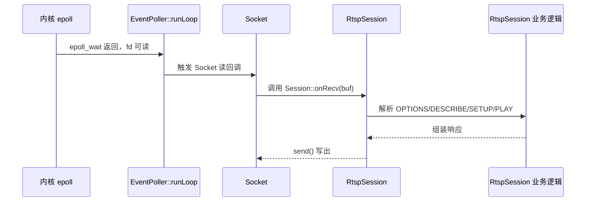

# 模块一・入门筑基 第 3 篇：ZLToolKit 核心能力概览

> 前置阅读：01-开篇-ZLMediaKit 能力全景与源码结构总览、02-编译环境搭建与源码调试实战
> 阅读建议：本篇是"概览"，先建立 ZLToolKit 的地图，不逐行抠实现。真正的源码精读放在模块二。

---

## 读完本篇你能搞懂什么

1. ZLToolKit 是什么、为什么 ZLM 要自研它、而不是依赖 boost/asio；
2. 它的四大能力块（Reactor 事件循环 / 线程池 / 网络层 / 工具集）各自管什么、如何协同；
3. 一次网络事件从"内核就绪"到"业务回调"的完整链路，以及这条链路为什么全程只跑在一个线程里；
4. 为什么"一路推流、多协议分发"这种能力的地基，恰恰埋在 ZLToolKit 里。

---

## 关键文件清单（概览阶段只需认识这 5 个）

| 目录 / 文件 | 对应能力 | 阅读优先级 |
|------|---------|-----------|
| `3rdpart/ZLToolKit/src/Poller/EventPoller.h` | Reactor 事件循环核心（`addEvent/runLoop`，epoll/kqueue/wepoll 统一抽象） | ⭐⭐⭐⭐⭐ |
| `3rdpart/ZLToolKit/src/Network/Socket.h` | Socket 异步封装，所有 IO 出入口 | ⭐⭐⭐⭐⭐ |
| `3rdpart/ZLToolKit/src/Network/Server.h` + `TcpServer.h` | TCP/UDP 服务端模板，Session 创建与 2 秒 Timer 周期管理 | ⭐⭐⭐⭐ |
| `3rdpart/ZLToolKit/src/Network/Session.h` | Session 基类（`onRecv/onManager/onError`），一切协议的"套壳"范式 | ⭐⭐⭐⭐⭐ |
| `3rdpart/ZLToolKit/src/Thread/WorkThreadPool.h` | 工作线程池（跑耗时任务，如 HLS 切片） | ⭐⭐⭐ |

> 记忆口诀：ZLToolKit 四块拼图 = **P**oller + **T**hread + **N**etwork + **U**til。

---

## 一、ZLToolKit 是什么：ZLM 的地基

ZLM 的 IO 和线程调度没有用 boost::asio / libuv / libevent，而是自己写了一套。原因很简单：通用网络库满足不了流媒体场景的几个硬需求——**单端口多线程 + 连接迁移、极致的延迟穿透调优、跨平台（含嵌入式龙芯/申威）、协议按需裁剪**。这些诉求后面会在对应能力块里具体展开。

> **理解模型 vs 逐行通读**：ZLToolKit 是 `3rdpart` 子模块，用 `git submodule` 引入。普通二次开发（加钩子、改切片、业务埋点）**不需要**碰它内部——你只需要知道"Session 回调跑在哪个线程、怎么发数据"；只有当你排查网络疑难、要自定义 Session 行为时，才下沉精读。

### 它在开篇那张全景图里的位置

回看第 1 篇的三层设计，ZLToolKit 就是最底层那层"网络运行时"。开篇说"一次推流，多协议分发"，这条能力链的起点其实在 ZLToolKit——推流端发来的字节，要先进 `TcpServer → Session::onRecv` 才能被解析成媒体帧；拉流端订阅的帧，最后也要从某个 Session 的 `send()` 写回网络。一句话：**ZLToolKit 决定"数据怎么进出"，ZLM 的媒体层决定"进来之后怎么办、出去之前怎么装"**。两者边界清晰，这正是你可以在完全不碰网络层的情况下，只改媒体层做二次开发的原因。

---

## 二、四大能力块总览

ZLToolKit 可以拆成四个能力块。不是孤立的——Poller 是事件循环，Thread 是线程池，Network 是网络层，Util 是工具集，数据从 Network 进、经 Poller 调度、回调到 Session：

```
                    ┌─ Util（工具集）logger / RingBuffer / NoticeCenter
                    │
Poller（事件循环）  ←─┤  Thread（线程池） EventPollerPool / WorkThreadPool
EventPoller/Timer   │
                    └─ Network（网络层）Socket / TcpServer / Session
```

下面逐个看每块管什么。

### 1. Poller（Reactor 事件循环）

核心是 `EventPoller`——每个网络线程一个。它把 **epoll（Linux）/ kqueue（macOS、BSD）/ wepoll（Windows）** 统一成一套接口，这是自研而非依赖 asio 的直接好处之一：asio 抽象层级太高，调优网络行为要穿透多层封装，自研 Poller 可以直接暴露事件回调、按需裁剪。

一个 EventPoller 管理一个 epoll 实例 + N 个 fd，内部用 `_event_map`（fd → 回调的 `unordered_map`）记录每个 fd 注册了什么回调。`runLoop()` 每次 `epoll_wait` 返回就绪 fd 列表，从 map 里查出回调逐个执行。这就是 Reactor 模型的核心：**一个线程 + 一个 epoll + N 个 fd + N 个回调**。EventPollerPool 默认 8 个这样的线程，整个服务的连接被均匀分到不同 poller 上。

- `addEvent(fd, event, cb)`：把某个 fd 挂进事件循环，事件就绪时回调；
- `delEvent` / `modifyEvent`：移除 / 修改监听；
- `runLoop()`：线程主循环，阻塞在 `epoll_wait` 上，就绪事件逐个派发。

`Timer` 通过 `EventPoller::doDelayTask()` 挂到同一套延时任务队列里（第 2 篇的 `onManager` 就是这么被 2 秒周期触发的）。

IO 事件、定时器、跨线程投递的任务（`async()`）都在这个循环里被处理——它是"事件 + 定时 + 任务"三合一的调度中枢。但也因为所有回调都挤在一个线程里跑，**任何一次阻塞都会卡死整条事件循环**，后面踩坑会展开。

### 2. Thread（线程模型）

先说继承链，这个是理解全部线程模型的钥匙：

```
TaskExecutor（任务执行器抽象基类，提供 async() + 负载统计）
└── EventPoller          每个实例 = 一个真实 pthread，跑事件循环

TaskExecutorGetterImp（池子接口，getPoller() 按负载挑一个）
├── EventPollerPool      管理一池子 EventPoller（默认 8 个），给网络 IO 用
└── WorkThreadPool       也管理一池子 EventPoller（默认 CPU 核数个），执行非 IO 密集型任务
```

`ThreadPool` 是 ZLToolKit 提供的另一种线程池：Worker 线程跑的是 `while(true){ _queue.get_task(); }` 的经典模型，没有 epoll、不监听事件、没有定时器。ZLM 核心代码里不用它——网络 IO 和非 IO 任务统一走 EventPoller，ThreadPool 留给外部使用者做简单任务并发。

**核心认知：每个 TaskExecutor 实例背后对应一个真实 pthread**。`getPoller()` 从 EventPollerPool 挑一个 EventPoller（= 一个网络线程），`WorkThreadPool::getPoller()` 挑的也是 EventPoller（= 一个工作线程）——两者都能 `async()` 丢任务、都能跑事件循环，但配置参数和默认数量不同、用途明确分开。

- **EventPollerPool**（默认 8 个网络线程）：`getPoller()` 按负载从池子里取一个 EventPoller，把新连接"绑"到那个线程。因为一条连接**只属于一个线程**，它的收发天然串行、无需加锁——这就是"单端口多线程"的实现根基，也是通用网络库做不到这么透明的一层。
- **WorkThreadPool**：默认 CPU 核数个 EventPoller，`WorkThreadPool::getPoller()->async(...)` 把耗时任务丢进去，不阻塞网络线程。HLS 切片、转封装、录制等非 IO 密集型任务都走这里。

### 3. Network（网络层）

`Socket` 是异步 IO 封装，所有 fd 操作最终都走这里；`TcpServer/UdpServer` 负责监听、新连接创建 Session、以及那个 2 秒周期 Timer；`Session` 是"一次连接 ↔ 一个对象"的抽象。`SessionWithSSL` / `SessionWithKCP` 是两个**组合模板**——用 `SSL_Box` / `KcpTransport` 把 TLS 和 KCP 能力"拼"到任意 Session 上，不用改业务代码。

### 4. Util（工具集）

`logger` 日志、`RingBuffer` 环形缓冲（媒体帧缓存的底座）、`NoticeCenter` 观察者式事件通知、`SSLBox`、`ResourcePool` 对象池等。这些是"看不见但到处在用"的螺丝钉。

---

## 三、一次读事件的生命周期：全链路只有一个线程

这是整个专栏最重要的认知之一。第 2 篇我们断点进过 `onManager`，现在把视角拉全：**一个 RTSP 客户端发来一包信令，代码是怎么一步步走到你的业务逻辑的？**



**关键事实**：上图中从内核到业务的**所有代码，都跑在同一个 EventPoller 线程里**。这就是为什么第 2 篇强调"绝不能在 onManager/onRecv 里做阻塞操作"——你一旦阻塞，这条线程上所有连接的事件都停摆。

单线程处理连接，天然无锁、无数据竞争，代码好写好调。但单线程吞吐有上限、不容忍任何耗时调用。ZLM 的应对是"**一个线程只管一件事**"——网络线程只做 IO 和轻量解析，真正的重活（HLS 切片、转封装）交给 WorkThreadPool。

> **理解模型 vs 逐行通读**：到这里，你已经"理解模型"了。`epoll_wait` 到底怎么注册 fd、`runLoop` 内部的事件分发表长什么样，属于模块二第 1 篇的精读范围。

> **扩展**：`runLoop` 不只是分派 IO 事件——延时任务（`doDelayTask`，第 2 篇的 `onManager` 就是）和跨线程投递的任务（`async()`）也都在这个循环里被处理。所以它是"事件 + 定时 + 任务"三合一的调度中枢，而不是单纯的 IO 多路复用。理解了这一点，你就明白为什么"在回调里 sleep"是全局灾难——它同时卡住了 IO、定时器和任务派发。

---

## 四、线程模型：EventPollerPool 与 WorkThreadPool 的分工

ZLM 的线程是分层的，这是读懂一切异步代码的地基：

```
┌─────────────────────────────────────────────┐
│ EventPollerPool（N 个网络线程，默认 8）       │
│  ├ EventPoller#0  → 一批连接的 Session 回调   │
│  ├ EventPoller#1  → 另一批连接的 Session 回调 │
│  └ ...                                        │
│  职责：IO + 协议解析（轻量）                  │
└─────────────────────────────────────────────┘
                    │ 非 IO 任务交给
                    ▼
┌─────────────────────────────────────────────┐
│ WorkThreadPool（工作线程池）                  │
│  职责：HLS 切片、转封装、DB/文件等耗时任务    │
└─────────────────────────────────────────────┘
```

- **EventPollerPool**：`getPoller()` 按负载/随机从池子里取一个 EventPoller，把新连接"绑"到某个网络线程。**单端口多线程**就是这么来的——一个监听端口，连接被均匀分到不同 poller 线程；UDP 还支持**连接迁移**（客户端网络从 Wi-Fi 切 4G，连接能迁移到别的线程，官方独有特性）。
- **WorkThreadPool**：`WorkThreadPool::getPoller()` 拿到一个工作线程（也是 EventPoller），把耗时任务 `async()` 丢进去，不阻塞网络线程。

网络线程保持轻快（低延迟），重任务隔离（不卡 IO），多核吃满。代价是跨线程的数据要同步，Session 对象不能在两个线程里同时访问——这是后续所有"对象生命周期"问题的根源，模块三会反复碰到。

> **生产监控**：怎么知道某个网络线程是不是被阻塞/过载了？ZLM 提供了 `getThreadsLoad` HTTP API，返回每个 epoll 线程的 `load`（0-100）和 `delay`（毫秒）。`delay` 异常大，基本就能定位到某个 poller 线程被卡住了——这比瞎猜高效得多。

#### getPoller() 怎么给连接分配线程

新连接进来，`EventPollerPool::getPoller()` 会从池子里挑一个 EventPoller（按负载或随机），把连接"绑"到那个线程。因为一条连接**只属于一个线程**，它的收发天然串行、无需加锁——这就是"单线程模型"红利落到工程上的体现，也是为什么 ZLM 的高并发代码能写得很干净。

#### 连接迁移：通用网络库给不了的能力

UDP 场景（典型如 WebRTC）下，客户端网络切换（Wi-Fi → 4G）时，ZLM 用 STUN 锁定客户端，把该连接的 fd 平滑迁移到另一个 poller 线程，业务侧无感知。这是 asio/libuv 这类通用库很难做到透明的一层，也是 ZLM 在弱网移动端场景的核心卖点之一。迁移期间的收发一致性问题，正是"连接只属于一个线程"这条规则的边界。

---

## 五、Session 模式：一切协议的"套壳"范式

最后落到那个反复出现的词：**Session**。回顾第 2 篇的断点——`RtspSession`、`RtmpSession`、`HttpSession`… 它们都是同一个套路：

```
TcpServer 收到新连接
   │ onAccept
   ▼
new XxxSession(socket)     ← 每个连接一个对象
   │
   ▼
SocketHelper（持有 Socket）→ 回调 Session::onRecv / onManager / onError（虚函数）
```

`Session` 基类 `class Session : public SocketHelper` 声明了这几个关键虚函数：

| 虚函数 | 触发时机 | 典型用途 |
|--------|---------|---------|
| `attachServer(server)` | Session 创建后 | 从 Server 拿配置参数 |
| `onRecv(buf)` | 收到数据 | 解析协议信令 |
| `onManager()` | 每 2 秒周期（TcpServer 内部 Timer） | 超时/心跳检查 |
| `onError(ex)` | 连接异常/断开 | 清理资源 |

**这就是"一切协议都是套壳"的技术根基**：上层协议（RTSP/RTMP/HTTP…）只是实现这几个虚函数、再把解析出的媒体帧塞进 `MediaSource`；而 IO 收发的骨架，全部由 ZLToolKit 的 Session 模式提供。

> **理解模型 vs 逐行通读**：到这里，你知道了"新连接 → new Session → 回调跑在 poller 线程 → 断开析构"。这就够了。Session 的 socket 底层、`Socket.cpp` 里 4 万行的实现细节，**只有当你自定义 Session、改网络行为时才需要读**——这正是"该读哪里"的判断。

---

## 六、常见问题排查（附真实来源）

### 问题 1：某个网络线程被阻塞，表现为"部分连接卡顿/掉线"

**现象**：同一进程里，有的连接正常、有的卡死；`getThreadsLoad` 查到某个 poller 的 `delay` 飙到几千毫秒。

**根因**：某条 Session 的回调里做了阻塞操作（同步读文件、调外部 HTTP、`sleep`），把这条 EventPoller 线程卡住，而这线程上的**所有连接一起遭殃**。

**排查**：
1. 调 `getThreadsLoad` API，看哪个线程 `delay` 异常（官方 RESTful API 文档：[docs.zlmediakit.com/guide/media_server/restful_api.html](https://docs.zlmediakit.com/guide/media_server/restful_api.html)）；
2. `gdb` attach 上去，`thread apply all bt` 看卡在哪；
3. 把耗时操作改成 `WorkThreadPool::getPoller()->async()` 丢到工作线程。

### 问题 2：连接数/端口耗尽导致播放器掉线

**现象**：高并发拉流（几万路）时，部分播放器掉线，服务端日志出现端口分配失败。

**根因**：ZLM 官方 4 万路 RTSP 拉流压测中就遇到"随机端口不够，播放器掉线（只剩 32244 个）"的真实问题——这是 UDP 源端口耗尽 + fd 上限双重作用，不是 ZLToolKit 本身的 bug（官方性能测试文档：[docs.zlmediakit.com/zh/reference/test/rtsp_pull_stream_performance_test.html](https://docs.zlmediakit.com/zh/reference/test/rtsp_pull_stream_performance_test.html)）。

**排查**：
1. 先 `ulimit -n` 调大 fd 上限（官方压测前都先 `ulimit -n 102400`）；
2. 检查 UDP 端口范围是否够用；
3. 参考官方压测文档里的调参，别一上来怀疑代码。

### 问题 3：线程数配错

**现象**：想提高并发，把 `thread_num` 调到很大，结果性能没涨、CPU 反而碎片化；或配小了，单线程成为瓶颈。

**根因**：网络线程（EventPollerPool）默认 8（`-t/--threads`，官方启动文档：[docs.zlmediakit.com/guide/media_server/start_server.html](https://docs.zlmediakit.com/guide/media_server/start_server.html)）。线程数不是越多越好——网络线程多了，跨线程对象迁移、缓存局部性都会劣化。

**排查**：按**CPU 核数**设网络线程数，工作线程按重任务量单独调，别图省事一把梭。

---

## 下一篇预告

模块一前两篇帮你把服务跑起来、能进断点。本篇把 ZLToolKit 这块地基画了地图。下一篇开始挖第一块砖：**模块二第 1 篇——Reactor 事件循环源码精读**，`EventPoller` 怎么用 epoll 注册 fd、`runLoop` 内部如何分发事件、`Timer` 和延时任务如何与事件循环耦合。

---

> **备注**：本专栏基于作者自身对 ZLMediaKit 源码的理解整理而成，受限于个人能力范畴与认知偏差，文中对代码逻辑、架构设计、实现细节的解读难免存在疏漏甚至错误。欢迎读者通过评论区、Issue 或直接邮件方式指正，作者会逐一核实并修订。
