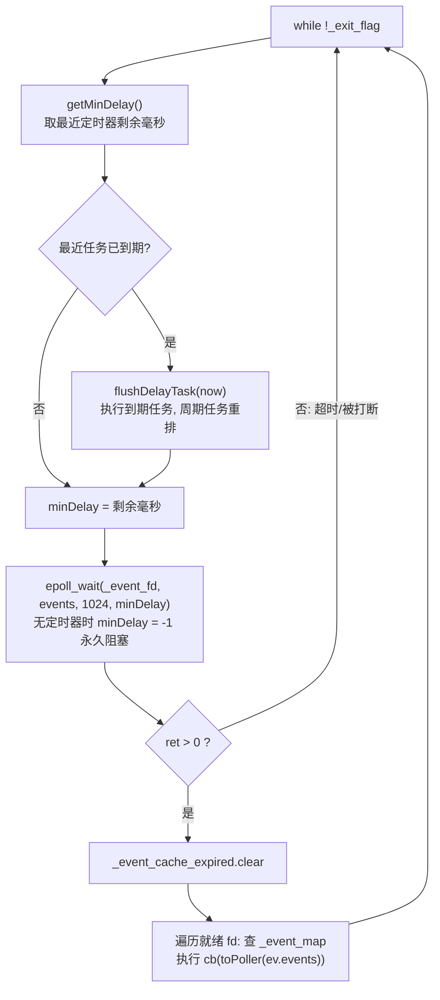
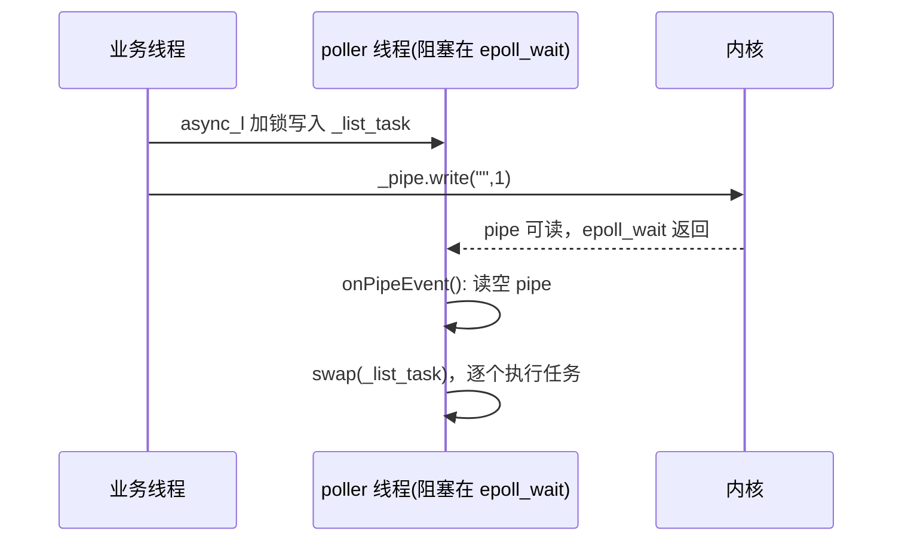
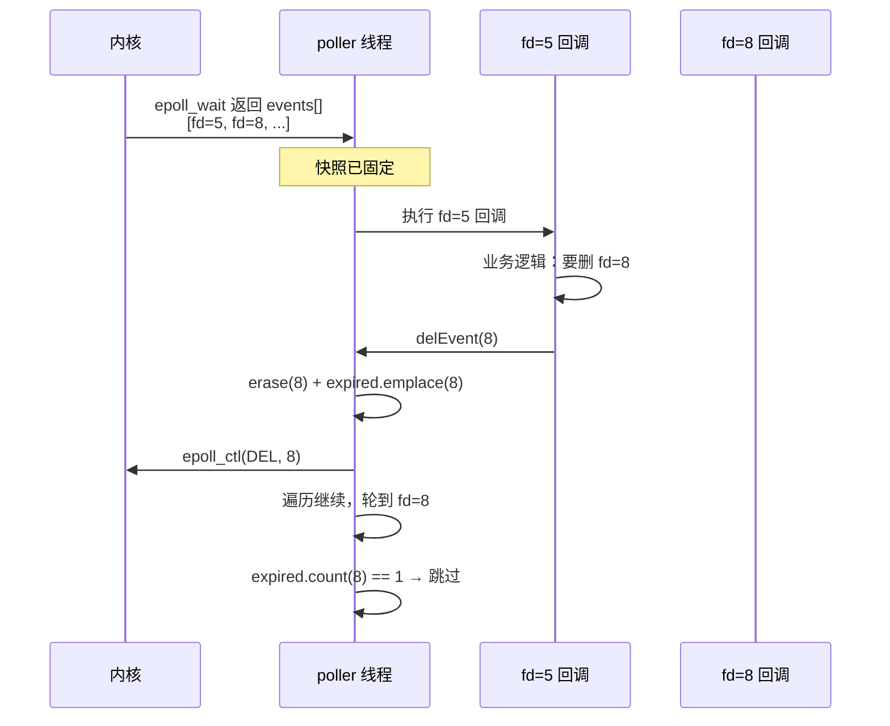

# 模块二・ZLToolKit 基石 第 1 篇：Reactor 事件循环源码精读

> 前置阅读：模块一第 3 篇——ZLToolKit 核心能力概览
> 阅读建议：本篇是**精读**。打开 `EventPoller.h` / `EventPoller.cpp` 对照读。

---

## 本篇主要讲述内容

1. `EventPoller` 如何用**一套代码**同时适配 epoll（Linux）、kqueue（macOS/BSD）、select（兜底），以及 Windows 为什么也能走 epoll 分支；
2. `runLoop` 一次循环里到底调度了哪三件事，以及"定时器"为什么不需要一个独立线程；
3. 跨线程 `addEvent` / `async` 为什么必须切回 poller 线程，pipe 唤醒的完整链路；
4. 为什么 ZLM 全程使用**边缘触发**（EPOLLET），以及它对回调提出的硬约束。

---

## 关键文件清单（精读重点在前）

| 文件 | 作用 | 锚点 |
|------|------|------|
| `3rdpart/ZLToolKit/src/Poller/EventPoller.h` | 类定义：事件位、成员、`EventPollerPool` | 事件位定义、成员变量表、池单例 |
| `3rdpart/ZLToolKit/src/Poller/EventPoller.cpp` | 实现：平台宏、`addEvent`、`runLoop`、定时器 | 平台适配、事件注册/删除、主循环、延时任务 |

> 选读：`SelectWrap.cpp`（select 分支 fd_set 封装）、`PipeWrap.cpp`（唤醒管道，Windows 用 TCP 环回模拟）、`Timer.cpp`（定时器上层封装）。这三个文件只在你需要理解平台适配或定时器参数时才需要翻。

> 阅读顺序建议：先看 `EventPoller.h` 的成员变量（理解它有哪些"零件"），再看 `EventPoller.cpp` 的 `runLoop`（理解这些零件怎么转起来），最后看 `addEvent / async` 那几条跨线程路径。

---

## 一、Poller 抽象：一套接口，三种实现

`EventPoller` 是 ZLToolKit 对 **IO 多路复用器** 的统一抽象——你可以把它理解成"Reactor 模型里那个阻塞在 epoll_wait / kqueue / select 上、等着 fd 就绪的中央循环"。它只做四件事：**把 fd 加进关注列表、从关注列表移除、修改关注条件、运行主循环**。ZLM 所有 TCP/UDP/KCP/WebRTC 连接的 IO 回调，最终都由它来派发。

跨平台是它最重要的一个设计点——在不同操作系统上，底层调用的 API 完全不同，但上层业务代码只认一套 `addEvent / delEvent / modifyEvent / runLoop` 接口。这个跨平台能力，藏在 `EventPoller.cpp` 开头的三组宏里：

```cpp
#if defined(HAS_EPOLL)        // Linux
#include <sys/epoll.h>
#define create_event() epoll_create(EPOLL_SIZE)
#define close_event(fd) close(fd)
#endif

#if defined(HAS_KQUEUE)       // macOS / BSD
#include <sys/event.h>
#define create_event() kqueue()
#define close_event(fd) close(fd)
#endif
```

Windows 并没有单独一套 API——它引入 `win32/wepoll`，用 `epoll_create/epoll_ctl/epoll_wait` 的兼容接口**模拟出 epoll**，所以也走 `HAS_EPOLL` 分支，唯一的区别是关闭时走 `epoll_close(fd)`。真正兜底的第三种实现，是 `#else` 里的 **select**。

所以"一套接口、三种实现"准确说是：**epoll（Linux + Windows/wepoll）、kqueue、select 兜底**。

上层只认 `Event_Read / Event_Write / Event_Error / Event_LT` 四个抽象事件位，平台差异全部收敛到宏和 `#if` 分支里，业务代码零感知。代价是 `#if` 分支写三套逻辑，改一处 poller 行为要同步改三处——这是自研跨平台库的隐性维护成本。

三套实现**不是对等关系**，其性能与行为差异如下：

| 实现 | 注册方式 | 每轮开销 | 硬限制 |
|------|---------|---------|--------|
| epoll / wepoll | `epoll_ctl` 增量注册，**内核维护红黑树存储 fd** | 只遍历就绪 fd（`ret` 个） | 单次最多 1024 个事件（`EPOLL_SIZE`） |
| kqueue | `kevent` 批量注册/注销 | 只遍历就绪 kevent | 同上，`KEVENT_SIZE 1024` |
| select | 无内核存储结构，**每轮重建全部 fd_set** | 全量遍历 `_event_map`，O(n) | `fd >= FD_SETSIZE` 直接拒绝 |

select 分支只是"能编译、能跑、能兜底"，**不适合生产环境高并发场景**——连接数一上来，每轮重建 fd_set 的 O(n) 开销和 `FD_SETSIZE` 上限（通常 1024）会先成为瓶颈。Linux/macOS 上 ZLM 的性能结论不能套到 select 分支上。

---

## 二、EventPoller 的对象模型

一个 `EventPoller` 实例 = **一个线程 + 一个事件实例 + 一条唤醒管道**。核心成员都在 `EventPoller.h` 的成员变量区：

| 成员 | 类型 | 作用 |
|------|------|------|
| `_event_fd` | `epoll_fd` / kqueue fd | 平台事件实例句柄 |
| `_event_map` | `unordered_map<int, ...>` | **fd → 回调**，事件派发的查找表 |
| `_event_cache_expired` | `unordered_set<int>` | **已删除 fd 的残留事件过滤标记**，防止回调已删的 fd |
| `_delay_task_map` | **`std::multimap<uint64_t, DelayTask::Ptr>`** | 按"到期时间戳"排序的定时任务表 |
| `_list_task` | `List<Task::Ptr>` + `_mtx_task` | 跨线程投递过来的任务队列 |
| `_pipe` | `PipeWrap` | 唤醒管道，读端注册在事件循环里 |
| `_loop_thread` | `std::thread*` | 跑 `runLoop` 的真实线程 |
| `_shared_buffer[2]` | `weak_ptr<SocketRecvBuffer>` | **本线程所有 Socket 共享的读缓冲**（TCP/UDP 各一） |

构造函数只做两件事：`create_event()` 拿到事件实例，然后 `addEventPipe()` 把 pipe 读端注册为 `Event_Read`，回调是 `onPipeEvent`。

注意 `_delay_task_map` 用的是 **multimap** 而不是 map：同一毫秒可能挂多个定时器，multimap 允许键重复且天然按时间有序，取最近任务是 `begin()`，O(1)。

---

## 三、runLoop：一个循环调度三件事

这是全篇的核心。先看一次循环的完整决策路径：



`runLoop` 的 epoll 分支去掉注释后是这样：

```cpp
struct epoll_event events[EPOLL_SIZE];
while (!_exit_flag) {
    minDelay = getMinDelay();                 // ① 算下一次该睡多久
    startSleep();
    int ret = epoll_wait(_event_fd, events, EPOLL_SIZE, minDelay);   // ② 睡到有事件或超时
    sleepWakeUp();
    if (ret <= 0) continue;                   // 超时/被打断，回到循环顶部

    _event_cache_expired.clear();
    for (int i = 0; i < ret; ++i) {           // ③ 派发就绪事件
        int fd = events[i].data.fd;
        if (_event_cache_expired.count(fd)) continue;     // 本轮已删除的 fd，跳过
        auto it = _event_map.find(fd);
        if (it == _event_map.end()) { epoll_ctl(_event_fd, EPOLL_CTL_DEL, fd, nullptr); continue; }
        (*it->second)(toPoller(events[i].events));
    }
}
```

一次循环其实在调度三件事：

1. **IO 事件**：`epoll_wait` 返回的就绪 fd，查 `_event_map` 拿到回调并执行；
2. **定时任务**：`getMinDelay()` 在进入 `epoll_wait` **之前**就把"已到期"的定时器执行掉了（见下）；
3. **跨线程任务**：靠 pipe 可读事件唤醒，在 `onPipeEvent` 里清空任务队列（第四节）。

而这三件事的"调度器"，就是 `epoll_wait` 的**超时参数** `minDelay`。

### 3.1 定时器怎么和事件循环耦合

```cpp
int64_t EventPoller::getMinDelay() {
    auto it = _delay_task_map.begin();
    if (it == _delay_task_map.end()) return -1;         // 没有定时器 → 永久阻塞
    auto now = getCurrentMillisecond();
    if (it->first > now) return it->first - now;        // 未到期 → 睡到它到期
    return flushDelayTask(now);                         // 已到期 → 先执行，再算下次
}
```

```cpp
int64_t EventPoller::flushDelayTask(uint64_t now_time) {
    decltype(_delay_task_map) task_copy;
    task_copy.swap(_delay_task_map);                        // 先摘出来，避免边遍历边改
    for (auto it = task_copy.begin(); it != task_copy.end() && it->first <= now_time; it = task_copy.erase(it)) {
        auto next_delay = (*(it->second))();                // 执行到期任务
        if (next_delay) {
            _delay_task_map.emplace(next_delay + now_time, std::move(it->second));  // 周期任务重排
        }
    }
    task_copy.insert(_delay_task_map.begin(), _delay_task_map.end());   // 剩余未到期任务归还
    task_copy.swap(_delay_task_map);
    return (_delay_task_map.empty() ? -1 : _delay_task_map.begin()->first - now_time);
}
```

它解释了"为什么 ZLM 不需要一个独立定时器线程"——定时器不是"到点回调"的独立机制，而是**把最近到期时间换算成 `epoll_wait` 的超时值**，让 IO 等待顺便把定时器也等了。

**核心洞察**：`minDelay` 同时承担两个语义——
- 有定时任务：它就是"最近一个任务的剩余毫秒"，`epoll_wait` 睡这么久后醒来执行；
- 没有定时任务：返回 `-1`，`epoll_wait` 永久阻塞，**零空转**。

这就是"事件 + 定时 + 任务"三合一的本质：**用一个阻塞点，统一等待三种唤醒源**。没有独立线程、无锁、无忙轮询；但定时精度受 IO 回调耗时影响（某个回调阻塞 500ms，到期定时器最多被推迟 500ms）。

### 3.2 定时任务怎么进来：doDelayTask

```cpp
EventPoller::DelayTask::Ptr EventPoller::doDelayTask(uint64_t delay_ms, function<uint64_t()> task) {
    DelayTask::Ptr ret = std::make_shared<DelayTask>(std::move(task));
    auto time_line = getCurrentMillisecond() + delay_ms;
    async_first([time_line, ret, this]() {
        // 异步执行的目的是刷新 select 或 epoll 的休眠时间
        _delay_task_map.emplace(time_line, ret);
    });
    return ret;
}
```

注意为什么用 `async_first` 而不是直接 `emplace`：插入新定时器后，`epoll_wait` 的休眠时长**必须重新计算**；而 `async_first` 会往 pipe 写一个字节，把循环从 `epoll_wait` 里叫醒，下一轮 `getMinDelay()` 自然带上新任务。注释里那句"刷新休眠时间"就是这个意思。

### 3.3 Poller 线程是怎么起来的

`runLoop(bool blocked, bool ref_self)` 有两个入口参数：

```cpp
if (blocked) {
    runLoop(true, ref_self);         // 直接在当前线程跑（主要给 select 分支用）
} else {
    _loop_thread = new thread(&EventPoller::runLoop, this, true, ref_self);
    _sem_run_started.wait();          // 等新线程走到 post() 再返回
}
```

- `blocked=false`：`new` 一个线程去跑 `runLoop`，**并用 `_sem_run_started` 做启动同步**——新线程在进入 while 循环前先做 `post()`，构造函数/池初始化因此不会出现"poller 已返回但循环还没转"的窗口期。
- `ref_self=true`：把自身写入 `thread_local s_current_poller`，这是 `EventPoller::getCurrentPoller()` 唯一的数据来源，也是"优先当前线程"的基础。

顺带一提，`startSleep()/sleepWakeUp()` 两次调用夹住 `epoll_wait`，统计的是"阻塞等待占总时间的比例"——这就是官方 `getThreadsLoad` 返回的 `load` 与 `delay` 的原始数据来源。**线程负载不是估算值，而是实测的等待/唤醒间隔**。

---

## 四、跨线程安全：async 与 pipe 唤醒

先解释一下"pipe 唤醒"里的 pipe 是什么：它是 POSIX 提供的一对 fd——往**写端**写数据，**读端**就会变成"可读"状态。ZLM 在每个 EventPoller 构造时创建这样一对 pipe，**把读端注册进 epoll 监听**，业务线程往写端写一个空字节，就能让阻塞在 `epoll_wait` 上的 poller 线程立刻返回——这就是"唤醒"。

为什么要多这一道？因为 poller 线程大部分时间阻塞在 `epoll_wait` 上等 IO，不阻塞时又在串行跑回调；业务线程跨线程投递任务时，poller 线程可能根本不在跑代码，任务队列进了也没人取。pipe 就是专门解决这个问题的"门铃"。

回到跨线程安全的核心设计——

`addEvent / delEvent / modifyEvent` 三兄弟有一个共同开头：**先判断是不是当前线程**：

```cpp
int EventPoller::addEvent(int fd, int event, PollEventCB cb) {
    if (isCurrentThread()) {
        epoll_ctl(_event_fd, EPOLL_CTL_ADD, fd, &ev);            // 直接操作
        _event_map.emplace(fd, std::make_shared<PollEventCB>(std::move(cb)));
        return ret;
    }
    async([this, fd, event, cb]() mutable {                       // 切回 poller 线程再操作
        addEvent(fd, event, std::move(cb));
    });
    return 0;
}
```

它是理解"ZLM 为什么线程安全"的关键——**事件的注册与派发永远在同一个线程**，所以 `_event_map` 不需要锁。

跨线程投递的实现：

```cpp
Task::Ptr EventPoller::async_l(TaskIn task, bool may_sync, bool first) {
    if (may_sync && isCurrentThread()) { task(); return nullptr; }   // 同线程可同步执行
    auto ret = std::make_shared<Task>(std::move(task));              // 先把 task 包成 Task 对象
    {
        lock_guard<mutex> lck(_mtx_task);
        first ? _list_task.emplace_front(ret) : _list_task.emplace_back(ret);
    }
    _pipe.write("", 1);                                               // 写一个字节唤醒 poller
    return ret;
}
```

唤醒链路完整时序：



`onPipeEvent` 做三件事：读空 pipe（不读空会残留一个字节，导致下一轮空唤醒）、`swap` 出任务队列（缩小锁范围）、逐个执行并捕获异常。特别地，它捕获 `ExitException` 后置 `_exit_flag = true`——这就是 `shutdown()` 能让 `runLoop` 退出的机制。

### `_event_cache_expired`：已删除 fd 的残留事件过滤标记

`delEvent` 删除 fd 时，会依次做两件事：`_event_map.erase(fd)` + `_event_cache_expired.emplace(fd)` + `epoll_ctl(DEL, fd)`。这个过滤标记解决的不是"先 epoll_wait 再 epoll_ctl 有 race"——epoll 本身的内核实现是可靠的，`epoll_ctl(DEL)` 之后内核不会再给这个 fd 派发事件。

真正需要过滤的场景，是**业务逻辑在某个 fd 的回调执行过程中，关闭了另一个 fd**（比如 Session A 检测到推流超时，直接关掉同进程里的 Session B）：`epoll_wait` 返回的 `events[]` 数组是一份**内核快照**，一旦返回就固定了。遍历这份快照的过程中，业务层调 Socket::close / Session::setOnClose 之类的方法关闭了另一个 fd，最终底层走到 `delEvent`——但被关闭的那个 fd 还在快照数组里等着被遍历。这个过滤标记就是用来跳过这类"快照里有、但遍历中途已被关闭"的 fd 的。



`_event_cache_expired.clear()` 是**每轮循环开头**（`epoll_wait` 返回之后、派发事件之前）清空。为什么放这个位置是安全的？因为 `epoll_wait` 返回到 `clear()` 之间这段窗口里，poller 线程只是在跑 `sleepWakeUp()` + `if (ret <= 0)` 判断，**没有任何入口能调度业务代码**（IO 回调、定时器回调、跨线程任务都必须从事件循环的"派发阶段"才能进来），单线程 Reactor 模型天然屏蔽了这个窗口里的业务删除场景。

那这个 clear 到底清的是什么？是**上一轮派发过程中残留的标记**。本轮派发过程中业务层删的 fd，标记进 expired 后，会在"本轮 clear 已经执行完、下一轮 clear 还没执行"的这段窗口里起到过滤作用——也就是下一次 `epoll_wait` 返回后、clear 之前的那一小段。

### `getPoller` 优先返回当前线程

```cpp
EventPoller::Ptr EventPollerPool::getPoller(bool prefer_current_thread) {
    auto poller = EventPoller::getCurrentPoller();        // 取 thread_local
    if (prefer_current_thread && _prefer_current_thread && poller) {
        return poller;
    }
    return static_pointer_cast<EventPoller>(getExecutor());   // 否则按负载挑
}
```

默认 `prefer_current_thread = true`。这形成一条闭环：**业务回调里再申请 poller，拿到的是"自己所在的那一个"**，于是后续 `addEvent/async` 都走 `isCurrentThread()==true` 的同步分支——不进任务队列、不写 pipe、不加锁。线程安全不是靠锁堆出来的，而是靠"始终操作本线程对象"这个不变量。

如果业务本意确实是"换个线程跑"，必须显式传 `false`，否则任务会**原地同步执行**——看起来"投递成功"，实际上卡住了当前线程。这是二次开发时很容易踩的一个语义陷阱。

---

## 五、Timer：定时器的最小封装

在进入 Timer 自身之前，先列一下它在 ZLM 里到底被用在哪里——不只是"某个工具类"，整个框架的连接管理几乎都靠它：

| 使用场景 | 源码位置 | 典型用法 |
|---------|---------|---------|
| **推流超时** | `RtspPusher` / `RtmpPusher` | `Timer(publishTimeoutSec, [...])` 超时踢掉推流端 |
| **拉流超时** | `RtspPlayer` / `RtmpPlayer` | `Timer(playTimeoutSec, [...])` 超时关闭拉流连接 |
| **心跳维持** | `RtspPusher` / `RtmpPusher` / `RtspPusher` | 按协议规定的间隔（RTSP 30s、RTMP 60s）定时发心跳包 |
| **KCP 拥塞控制** | `KcpTransport` | KCP 协议内部的重传定时器，丢包后按 RTO 重发 |
| **RTP 丢包重传** | `RtpProcess` | WebRTC 的 NACK/TWCC 反馈、丢包检测定时 |
| **HLS 切片** | `HlsPlayer` | 定时拉取下一片 .ts |
| **连接超时检查** | `TcpServer` | 每 2 秒对所有 Session 跑 `onManager`（用 `doDelayTask` 直接挂，不是 Timer 封装） |
| **Pacer 限速** | `MultiMediaSourceMuxer` | `_paced_sender->resetTimer` 控制 RTP 发送节奏 |
| **C API 延时** | `api/source/mk_thread.cpp` | `mk_media_source_start_check_timer` 等对外暴露的延时回调 |

可以说没有 Timer，ZLM 的连接管理就动不起来——整个框架的心跳、超时、定时触发，全部落脚在 EventPoller 的延时任务队列上，Timer 只是这个队列上最常用的一层薄封装。

`Timer` 本身极薄：构造时算出毫秒数，直接调 `_poller->doDelayTask()`；回调返回非 0 就按返回值周期重复，返回 0 就停止。

```cpp
Timer::Timer(float second, const std::function<bool()> &cb, const EventPoller::Ptr &poller) {
    _tag = _poller->doDelayTask((uint64_t)(second * 1000), [cb, second]() {
        try {
            if (cb()) return (uint64_t)(1000 * second);   // 返回下次延时 → 周期任务
            return (uint64_t) 0;                           // 0 → 不再重复
        } catch (std::exception &ex) {
            ErrorL << "Exception occurred when do timer task: " << ex.what();
            return (uint64_t)(1000 * second);              // 异常也继续重复
        }
    });
}
```

这里有个容易被忽略的语义差：`doDelayTask` 层的约定是"**任务抛异常默认不再重复**"，但 `Timer` 在 lambda 内部自己 `catch` 了，所以异常**不会让定时器停摆**，而是打一条 `ErrorL` 后继续按周期跑。排查"某个定时任务挂了但日志刷屏"时，要分清是哪一层的异常处理生效。

这就解释了第 2 篇那个"`onManager` 每 2 秒触发"的链路：`TcpServer` 内部 `Timer(2.0f, ...)` → `doDelayTask(2000, ...)` → 挂进 `_delay_task_map` → `getMinDelay` 把它算成 `epoll_wait` 的超时 → 到点执行 `onManagerSession`。**没有任何独立定时线程**。

flushDelayTask 里先 swap 摘出整个 map、再执行到期任务、再把未到期的归还——这么做是因为 multimap 遍历时 emplace 可能导致内部节点重排，直接边遍历边改会让迭代器失效。

---

## 六、设计决策

### 6.1 默认边缘触发（EPOLLET）

```cpp
#define toEpoll(event)  (((event) & Event_Read)  ? EPOLLIN : 0) \
                      | (((event) & Event_Write) ? EPOLLOUT : 0) \
                      | (((event) & Event_Error) ? (EPOLLHUP | EPOLLERR) : 0) \
                      | (((event) & Event_LT)    ? 0 : EPOLLET)
```

最后一行：**不传 `Event_LT` 就加 `EPOLLET`**，也就是默认边缘触发。全仓库查 `Event_LT`，只查到定义处和这行使用处——**没有任何业务代码传入 `Event_LT`**。ZLM 运行时全程边缘触发，没有任何一个 fd 是水平触发。

先快速过一遍两种触发模式的定义，后面踩坑章节会反复用到：

| 模式 | 触发条件 | 数据未读完会怎样 | 对回调的硬约束 |
|------|---------|----------------|--------------|
| **水平触发（LT）** | fd **仍然处于**可读/可写状态 | 下次 `epoll_wait` 还会再返回这个 fd | 无特别约束 |
| **边缘触发（ET）** | fd 状态**发生变化**（不可读→可读） | 内核缓冲还有数据但状态没变，**不再通知** | 必须一次性读空到 `EAGAIN` |

ET 只在"状态跳变"时通知一次，配合"一次读空"的读循环，通知次数最少、系统调用最少——这是它在高并发场景下的性能优势。但代价就是那个硬约束：只读一次不读空，剩余数据会被"遗忘"，表现就是"连接假死/消息丢失"。ZLM Socket 层的读逻辑，就是为了满足这个硬约束而写的。

### 6.2 每线程共享读缓冲 `_shared_buffer[2]`

EventPoller 内部有个 `SocketRecvBuffer::weak_ptr _shared_buffer[2]`，**按需创建**——第一次有 Socket 注册读事件时才分配，存 weak_ptr 是为了没人用了自动释放。

**工作方式**：每个 Socket 在注册读事件时（Socket.cpp 里），从 poller 拿到这块 buffer 的 shared_ptr，**捕获到读回调 lambda** 里。fd 可读触发时，回调参数里就带着这块 buffer，用它调 `recvfromSocket` 把内核数据读进内存。

**工作流程**：**fd A 的回调用这块 buffer 读完包、处理完，fd B 的回调接着用同一块 buffer 读自己的包**。这个"轮流用"能工作，是因为同一个 poller 线程上所有回调**串行执行**（没有并发），不会出现"A 刚读到一半 B 抢过来写"的情况。

非 Linux 平台更极端：`_shared_buffer[2]` 只用到 index 0——**TCP 和 UDP 共享同一块 buffer**（源码 `#if !defined(__linux)` 强制把 `is_udp` 设为 0），因为 kqueue/select 上 TCP 也用 recvfrom 路径。

代价：这块 buffer 不是"读完即丢"的裸 `char[]`，是带内部状态的 SocketRecvBuffer 对象，里面有 BufferList 存 UDP 多包数据；而且 buffer 生命周期绑定 poller 线程，跨线程不能用。如果某个回调把 buffer 里的数据拷出去后还长期持有 buffer 引用，那这块内存就被钉住了，影响后续 fd 的读取。

---

## 七、常见问题排查

### 问题 1：边缘触发下"只读一次"，事件再也不来

**现象**：客户端持续发数据，服务端却只处理了第一包，后续数据"消失"，连接看似存活但业务不动。

**根因**：`toEpoll` 默认加 `EPOLLET`，且全仓库无人传 `Event_LT`——边缘触发只在"从无到有"时通知一次。回调没读空，内核缓冲还有数据，但状态没变化，`epoll_wait` 不再返回该 fd。

**排查**：确认读循环是否读到 `EAGAIN` 才退出；自定义 Session 时最容易出现。

### 问题 2：跨线程直接 `epoll_ctl` / 改 `_event_map`

**现象**：偶发崩溃、事件丢失、`_event_map` 迭代异常。

**根因**：`addEvent` 的设计前提是"注册与派发同线程"。绕过它、在业务线程直接操作 `_event_map` 或 `epoll_ctl`，就破坏了这条不变量。

**正确做法**：永远走 `addEvent / delEvent / modifyEvent` 或 `async()`，让框架帮你切线程。

---

## 下一篇预告

模块二第 2 篇——**线程模型（ZLToolKit 层）**：`TaskExecutor` / `TaskExecutorGetterImp` / `EventPollerPool` / `WorkThreadPool` 的源码关系，`getExecutor()` 如何按负载挑线程、`async()` 跨线程派发怎么保证顺序，以及 ZLM 的网络线程与工作线程到底怎么分工。

---

> **备注**：本专栏基于作者自身对 ZLMediaKit 源码的理解整理而成，受限于个人能力范畴与认知偏差，文中对代码逻辑、架构设计、实现细节的解读难免存在疏漏甚至错误。欢迎读者通过评论区、Issue 或直接邮件方式指正，作者会逐一核实并修订。
