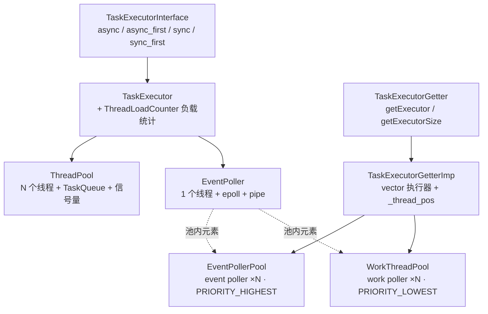
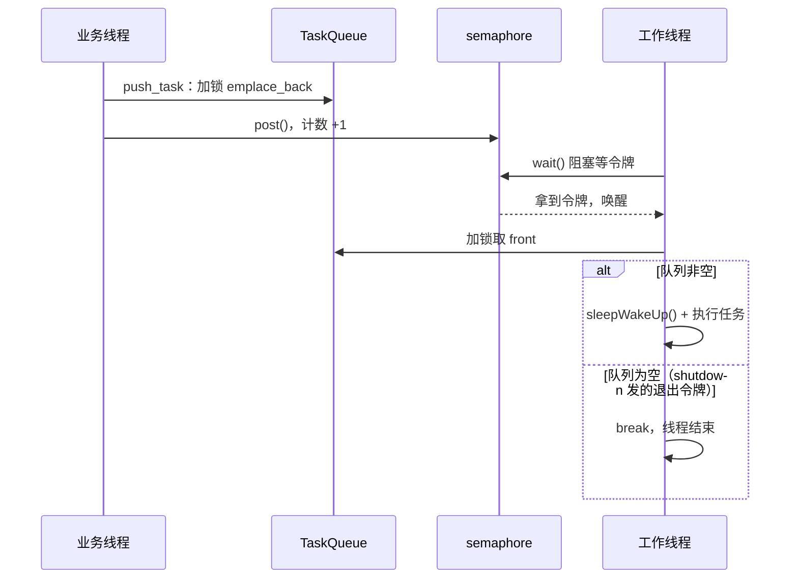
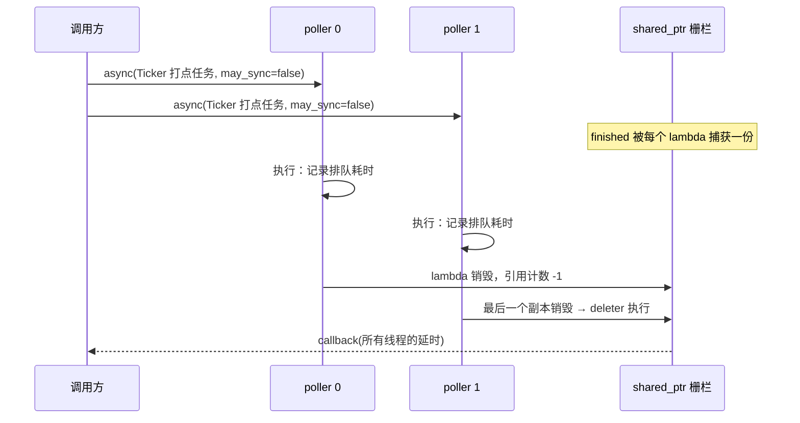

# ZLToolKit 线程模型：线程池、任务队列与执行器分工

> 模块二 · 第 2 篇 | 前置阅读：《Reactor 事件循环源码精读》

## 本篇主要讲述内容

上一篇只讲了一个 `EventPoller` 怎么转起来。真实进程里有一堆线程：网络线程、工作线程、日志线程——它们不是散落的 `std::thread`，而是统一挂在两套池上。

本篇回答四个问题：

1. `TaskExecutor` / `ThreadPool` / `EventPoller` / `EventPollerPool` 的继承关系与分工；
2. `ThreadPool` 里的线程怎么阻塞、怎么被唤醒、又怎么退出；
3. 同样叫"池"，`EventPollerPool` 和 `WorkThreadPool` 差别在哪，为什么要两套；
4. 一个任务从"投递"到"被执行"经过哪些对象，负载均衡又是怎么选的。

读完你能自己判断：手上的回调该投给哪个池，投错了会出什么问题。

## 关键文件清单（精读重点在前）

| 文件 | 读什么 |
|------|--------|
| `src/Thread/TaskExecutor.h` | 四个投递方法的契约、`TaskCancelableImp`、`ThreadLoadCounter`、`TaskExecutorGetterImp` |
| `src/Thread/TaskExecutor.cpp` | `sync` 的信号量等待、`getExecutor` 负载选择、`getExecutorDelay`、`addPoller` |
| `src/Thread/ThreadPool.h` | 线程池全部实现（**只有头文件，没有 .cpp**） |
| `src/Thread/TaskQueue.h` | 任务队列 + 信号量 |
| `src/Thread/semaphore.h` | 两套信号量实现（平台分支） |
| `src/Thread/threadgroup.h` | 线程集合与 `is_this_thread_in` |
| `src/Thread/WorkThreadPool.cpp` | 只有单例和构造（一行 `addPoller`） |
| `src/Poller/EventPoller.cpp` | `runLoop` 的阻塞点选择、两套池的构造参数 |
| `src/Util/util.cpp` | 线程名、优先级、CPU 亲和性的平台实现 |
| `server/main.cpp` | 线程数和亲和性的命令行入口 |

---

## 一、四层抽象：一张图看清谁管谁

先看结构。ZLToolKit 的线程体系只有两个关注点：**"一个执行器怎么执行任务"** 和 **"一堆执行器里挑哪一个"**。



三条结论先摆出来：

- `TaskExecutor` 继承 `ThreadLoadCounter`（负载统计）和 `TaskExecutorInterface`（任务契约），是"可执行任务 + 可上报负载"的最小单元；
- `ThreadPool` 和 `EventPoller` 是它的两个实现：一个阻塞在信号量上，一个阻塞在 `epoll_wait` 上；
- `EventPollerPool` 和 `WorkThreadPool` 都继承 `TaskExecutorGetterImp`，**池里装的都是 EventPoller**，不是 ThreadPool。

最后一点很关键：ZLM 的 `src/` 和 `server/` 里没有任何 `new ThreadPool`，业务侧的线程全部由这两套 EventPoller 池提供。`ThreadPool` 是 ZLToolKit 留下的通用实现，本篇讲它是因为它把 `TaskQueue + 信号量` 这套机制暴露得最干净——EventPoller 的跨线程投递只是把"信号量"换成了"pipe"。

## 二、公共契约：四个投递方法

`TaskExecutorInterface` 只有四个方法，语义全在 `may_sync` 这个参数上：

| 方法 | 同线程时的行为 | 跨线程时的行为 |
|------|--------------|--------------|
| `async(task, may_sync=true)` | `may_sync` 为真：**原地同步执行，返回 nullptr**；为假：照样入队 | 入队，返回 `Task::Ptr` |
| `async_first(task)` | 同上 | 插到队首 |
| `sync(task)` | 同上（不阻塞） | 入队后信号量等待 |
| `sync_first(task)` | 同上 | 插队 + 等待 |

`may_sync=true` 不是性能优化，而是线程安全的基础：**谁在自己的线程里投递，就不进队列、不加锁、不唤醒**。上一篇讲的 `getPoller` 优先返回当前线程，就是在利用这条路径。

四个方法的实现其实只有两层：子类各自实现 `async` 和 `async_first`，基类用它们包出 `sync` 和 `sync_first`。先看底层的 `async`（`ThreadPool` 和 `EventPoller` 的版本逻辑完全一样，只是队列和唤醒机制不同）：

```cpp
// ThreadPool.h（EventPoller::async_l 逻辑相同）
Task::Ptr async(TaskIn task, bool may_sync = true) override {
    if (may_sync && _thread_group.is_this_thread_in()) {
        task();                         // 同线程：原地执行，不进队列
        return nullptr;
    }
    auto ret = std::make_shared<Task>(std::move(task));
    _queue.push_task([ret](size_t) {   // 跨线程：包进 shared_ptr 入队
        (*ret)();
    });
    return ret;                         // 返回 Task::Ptr，调用方可 cancel
}
```

`async_first` 的实现完全相同，只把 `_queue.push_task` 换成 `_queue.push_task_first`——EventPoller 里就是 `_list_task.emplace_front`。子类实现这两个之后，基类就能自动得到 `sync` 和 `sync_first`——只是给任务套了一层"执行完 sem.post()"的 RAII，然后调用方自己 `sem.wait()`。

`sync` 的实现（基类唯一版本，EventPoller 和 ThreadPool 都没重写它）：

```cpp
void TaskExecutorInterface::sync(const TaskIn &task) {
    semaphore sem;
    auto ret = async([&]() {
        onceToken token(nullptr, [&]() {
            sem.post();
        });
        task();
    }, true);
    if (ret && *ret) {
        sem.wait();
    }
}
```

`sync_first` 就是把里面的 `async` 换成 `async_first`，仅此而已。

两个细节：

- `onceToken`（`Util/onceToken.h`）是一个最简单的 RAII 守卫。它有两个构造函数：一个构造时立刻执行回调、析构时再执行一次；另一个就是这里用的 `onceToken(nullptr, lambda)`——**构造时什么都不做，把 lambda 存起来，对象离开作用域时才调**。不管 `task()` 是正常 return 还是中途抛异常，`onceToken` 都会被析构，`sem.post()` 必然执行一次。否则任务抛异常时调用方的 `sem.wait()` 就永远等不到 post，直接永久阻塞。
- `if (ret && *ret)` 有两层检查，对应 `async` 的两条返回路径和 Task 的可取消机制：
  - **同线程同步路径**：`may_sync=true` 且目标就是当前线程，`task()` 原地执行完直接 `return nullptr`。此时任务已经跑完、`sem.post()` 已经发过了，再 `wait` 就是"没 post 也等"，永久阻塞——所以 `ret == nullptr` 时必须跳过 wait。
  - **跨线程入队路径**：把任务包成 `shared_ptr<TaskCancelableImp>` 放进队列，返回这个 shared_ptr。`*ret` 调的是 `TaskCancelableImp::operator bool()`，等价于 `_strongTask && *_strongTask`——如果任务对象自己析构时顺带 cancel 了、或者外部（走 async 不走 sync 的场景）在队列执行前调了 `cancel()`，`*ret` 就是 false。**不过 ZLM 业务代码里几乎没拿 async 的返回值进行 cancel**，所以这个检查在实际运行中几乎不会被触发。
  - 只有 `ret != nullptr && *ret == true` 才是"任务在队列里、有效"，需要等它执行完。

**顺带说一个容易被问出来的竞态窗口**：如果在 `sem.wait()` 已经开始阻塞之后、任务还没出队之前，任务对象自己析构触发 cancel 会怎样？cancel 把 `_strongTask` 置空，任务出队执行时 `operator()` 里 `weak_ptr.lock()` 失败直接 return——onceToken 不会被构造，`sem.post()` 永远不发，sync 永久阻塞，这个只是在二次开发的时候需要留意。

`Task` 的类型是 `TaskCancelableImp<void()>`。它内部同时持 `_strongTask`（shared_ptr）和 `_weakTask`（weak_ptr），每次 `operator()` 都先 `lock()` 一次：

```cpp
R operator()(ArgTypes ...args) const {
    auto strongTask = _weakTask.lock();
    if (strongTask && *strongTask) {
        return (*strongTask)(std::forward<ArgTypes>(args)...);
    }
    return defaultValue<R>();
}
```

`cancel()` 只把 `_strongTask` 置空，weak 自然失效。这样即使队列里还压着一个任务、外部也已析构，回调不会访问到已释放的对象——**用弱引用把"任务生命周期"和"对象生命周期"解耦**。

## 三、ThreadPool：阻塞在信号量上的工作线程

`ThreadPool.h` 是纯头文件实现，170 行搞定。整个线程池只有三个成员：`thread_group _thread_group`、`TaskQueue _queue`、`std::function<void(int)> _on_setup`。下面把它的完整生命周期串成一段看：

```cpp
// 构造：存下设置动作，不直接建线程
ThreadPool(int num, Priority priority, bool auto_run, bool set_affinity, string pool_name) {
    _thread_num = num;
    _on_setup = [pool_name, priority, set_affinity, num](int index) {
        // 线程属性（优先级/名字/亲和性）存成 lambda，稍后由线程自己执行
        setPriority(priority);
        setThreadName(pool_name.data());
        if (set_affinity) setThreadAffinity(index % thread::hardware_concurrency());
    };
    if (auto_run) start();
}

// start：建 N 个线程，每个跑 run(index)
void start() {
    for (size_t i = 0; i < _thread_num; ++i) {
        _thread_group.create_thread([this, i]() { run(i); });
    }
}

// run：每个线程的主循环
void run(size_t index) {
    _on_setup(index);                       // ① 线程自己设自己的属性（pthread_setschedparam 认当前线程）
    std::function<void(size_t)> task;
    while (true) {
        startSleep();                       // ② 标记开始 sleep（负载统计）
        if (!_queue.get_task(task)) break;  // ③ 阻塞等信号量，空任务则退出
        sleepWakeUp();                      // ④ 标记结束 sleep
        try {
            task(index);                    // ⑤ 执行任务
            task = nullptr;
        } catch (std::exception &ex) {
            ErrorL << "ThreadPool catch a exception: " << ex.what();  // 只打日志，线程不死
        }
    }
}

// 队列：一把 mutex + 一个信号量 + List
template<typename T> class TaskQueue {
    std::mutex _mutex;
    semaphore _sem;
    List<T> _queue;
public:
    void push_task(T task) {        // 生产者：先入队再 post
        { lock_guard<mutex> lck(_mutex); _queue.emplace_back(std::move(task)); }
        _sem.post();
    }
    bool get_task(T &tsk) {         // 消费者：先 wait 再取
        _sem.wait();
        lock_guard<mutex> lck(_mutex);
        if (_queue.empty()) return false;   // wait 到但队列为空 → 退出令牌
        tsk = std::move(_queue.front());
        _queue.pop_front();
        return true;
    }
    void push_exit(size_t n) { _sem.post(n); }   // shutdown：多 post N 个令牌
};

// 析构：shutdown 发 N 个退出令牌 → join_all 等线程结束
~ThreadPool() { shutdown(); wait(); }
```

串起来看，ThreadPool 的设计有几个要点：

**① 线程属性必须由线程自己设**。`_on_setup(index)` 在 `run` 第一行执行，不是构造函数里设。因为 `pthread_setschedparam` 认的是"调用方线程"，Windows 的 `SetThreadPriority` 也作用于当前线程——在哪个线程里调，就改哪个线程的属性，构造函数里调改的是主线程。

**② 阻塞点是信号量不是条件变量**。TaskQueue 用的是 `semaphore::wait()` 而不是 `condition_variable::wait()`，所以消费者不需要 while 循环防止虚假唤醒——信号量的计数语义天然不会丢事件。代价是 `push_task` 必须先 `emplace_back` 再 `post`，顺序不能反。

**③ 退出机制是 N 个"空令牌"。`shutdown()` 只做 `_sem.post(_thread_num)`，没有往队列里塞任何东西。线程 `wait()` 到令牌后发现队列为空就 break。但有个前提：**shutdown 之后必须立刻 wait（join_all）**，如果 shutdown 之后还在往队列里投任务，退出令牌会被"取任务"的循环消耗掉，线程可能多跑几轮才退出。析构函数里 `shutdown(); wait();` 是连着的，所以一般没问题。

**④ 异常不杀线程**。`catch` 只打日志，线程继续 while 循环。任务抛异常最多丢一次执行。

**⑤ `startSleep()` / `sleepWakeUp()` 在 wait 前后成对调用**——wait 之前调 `startSleep()` 标记 sleep 开始，wait 返回后调 `sleepWakeUp()` 标记 run 开始，"等任务"的时间计入 sleep、"执行任务"的时间计入 run。`EventPoller` 用的是同一对函数，只是包围的是 `epoll_wait`，不是 `_queue.get_task`。同一个负载统计器，被两种等待复用。

一张时序图看完整交互：



## 四、EventPoller：同样是 TaskExecutor，阻塞点不同

`EventPoller` 也继承 `TaskExecutor`，覆写 `async/async_first` 走 `async_l`：同线程同步执行；跨线程把任务塞进 `_list_task`，再往 pipe 写一个字节唤醒 `epoll_wait`（细节见上一篇）。

把它和 `ThreadPool` 并排看，两者的差别只有"等在哪"：

| 维度 | `ThreadPool` | `EventPoller` |
|------|-------------|--------------|
| 线程数 | N | 1 |
| 阻塞点 | `semaphore::wait` | `epoll_wait` |
| 唤醒源 | 信号量计数 | fd 就绪 / pipe 字节 / 定时器到期 |
| 任务容器 | `TaskQueue<std::function<void(size_t)>>` | `List<Task::Ptr> _list_task` |
| 互斥 | `TaskQueue::_mutex` | `_mtx_task` |

为什么不干脆用 `ThreadPool` 跑事件循环？因为**一个线程在同一时刻只能堵在一个地方**，而 `ThreadPool` 的线程只堵在 `semaphore::wait` 上——它本身没有 `epoll_wait`，这正是"纯任务队列"的设定。

矛盾是在"想让它顺手把 IO 也管了"的时候才出现的：一旦把 `epoll_wait` 塞进这个线程，它就有了两个互不相干的堵点，而系统里没有"任务入队时顺手叫醒 `epoll_wait`"这种通知。于是只能排先后，排哪个都漏：

- 先等信号量：IO 数据在这期间到了，`epoll_wait` 没人调，数据躺在内核缓冲区里没人收；
- 先等 `epoll_wait`：任务在这期间入队了，没人取，回调一直不跑。

`EventPoller` 的办法不是"同时等两个"，而是**只保留一个堵点，把另外两件事改造成 `epoll_wait` 能等到的东西**：

| 要等的东西 | 怎么变成 `epoll_wait` 的事 |
|---|---|
| 跨线程任务 | 往 pipe 写一个字节，pipe 可读对 epoll 来说就是一个普通 fd 事件 |
| 定时器到期 | 把最近一个到期时间换算成 `epoll_wait` 的超时毫秒数，超时返回即到期 |
| 网络 IO | 本来就注册在 epoll 里 |

三种唤醒源并成一个，一次 `epoll_wait` 返回就能一起处理，不用轮询、也不用排先后。

那"给 `ThreadPool` 也塞个 pipe + `epoll_wait`"行不行？行，但塞完它就不是 `ThreadPool` 了：线程从"等信号量"变成"等 epoll"，任务队列靠 pipe 唤醒——这些合起来正好就是 `EventPoller` 的定义。所以 ZLToolKit 保留了两种执行器：`ThreadPool` 始终保持"纯任务队列"这一个阻塞点，`EventPoller` 则把"IO + 任务 + 定时器"三路统一进同一个 `epoll_wait` 阻塞点。

## 五、EventPollerPool vs WorkThreadPool：两套 EventPoller 池，不是两套 ThreadPool

先澄清一个最容易被名字坑的事实：**这两个"池"里装的全是 EventPoller，没有一个 ThreadPool**。

`WorkThreadPool` 这个名字是历史遗留。早期 ZLToolKit 可能打算让它用 ThreadPool 实现"纯任务执行器"，后来发现 EventPoller（只管"阻塞点不同"）完全能胜任，就统一了类——但类名没改。

它们的构造函数体都只有一行核心调用，都调同一个 `TaskExecutorGetterImp::addPoller`，参数只差五个：

```cpp
// WorkThreadPool 构造函数（体：一行）
WorkThreadPool::WorkThreadPool() {
    addPoller("work poller", s_pool_size, ThreadPool::PRIORITY_LOWEST, false, s_enable_cpu_affinity);
}

// EventPollerPool 构造函数（体：一行核心 + 通知 + 日志）
EventPollerPool::EventPollerPool() {
    auto size = addPoller("event poller", s_pool_size, ThreadPool::PRIORITY_HIGHEST, true, s_enable_cpu_affinity);
    NOTICE_EMIT(EventPollerPoolOnStartedArgs, kOnStarted, *this, size);  // 广播"池已建好"
    InfoL << "EventPoller created size: " << size;
}
```

逐项对比：

| 项 | `EventPollerPool` | `WorkThreadPool` |
|----|------------------|------------------|
| 线程名 | `event poller 0..N` | `work poller 0..N` |
| 优先级 | `PRIORITY_HIGHEST` | `PRIORITY_LOWEST` |
| `register_thread` | `true` | `false` |
| 默认数量 | `hardware_concurrency()` | 同左 |
| `getPoller()` 是否查 thread_local | **是**（先查 `getCurrentPoller()` 再 fallback） | **否**（直接 `getExecutor()` 按负载挑） |
| 典型用途 | 网络 IO、定时器、协议回调 | FFmpeg 解码、录像落盘、耗时任务 |

先根据线程启动过程解释`register_thread` 参数：

```cpp
// 第 1 步：addPoller 入参 register_thread
EventPoller::Ptr poller(new EventPoller(full_name));
poller->runLoop(false, register_thread);   // blocked=false → 外部线程调用，让框架去开新线程

// 第 2 步：runLoop 的 blocked=false 分支开新线程
} else {
    // 开新线程，register_thread==ref_self
    _loop_thread = new thread(&EventPoller::runLoop, this, true, ref_self);
    _sem_run_started.wait();
}

// 第 3 步：runLoop 的 blocked=true 分支（新线程真正执行的入口）
if (blocked) {
    if (ref_self) {                                      // register_thread 的值一路传到这里
        s_current_poller = shared_from_this();           // 唯一的赋值动作
    }
    _sem_run_started.post();
    // ...进入 epoll_wait/select/poll 的 while 循环
}
```

配合一个 thread_local 变量提供查询入口：

```cpp
static thread_local std::weak_ptr<EventPoller> s_current_poller;

EventPoller::Ptr EventPoller::getCurrentPoller() {
    return s_current_poller.lock();
}
```

这一行声明拆开看是三件事：

1. `thread_local`：**每个线程各有一份这个变量**，互相独立，初始是空的 `weak_ptr`。20 个线程就有 20 份，某个线程写进去的值只有它自己这个线程读得到；
2. 它存的不是 poller 对象，只是"这条线程上正在跑哪个 poller"的**弱引用**；poller 对象本身是池里 `new EventPoller(...)` 出来的；
3. 用 `weak_ptr` 而不是 `shared_ptr`，是为了池把 poller 释放后 `lock()` 返回空，`thread_local` 不会拖着对象让它析构不掉。

所以 `getCurrentPoller()` 的语义就一句话：**当前线程如果是 poller 线程，返回它正在跑的那个 poller；否则返回空。**

赋值只有一处：

```cpp
if (ref_self) {                                  // ref_self = register_thread
    s_current_poller = shared_from_this();
}
```

所以**被赋值的线程数 = `register_thread=true` 的线程数**，不是"所有跑了 runLoop 的线程数"：

| 线程 | 跑 runLoop | `register_thread` | 变量有值吗 |
|---|---|---|---|
| `EventPollerPool` × N | 是 | `true` | 有，N 个线程各赋一次 |
| `WorkThreadPool` × N | 是 | `false` | 无，始终为空 |
| 主线程 / 日志线程 / HTTP 线程 | 否 | — | 有这份变量，但没人赋值 |

举个具体例子：进程 20 个线程，其中网络池 8 个、工作池 8 个、其余 4 个是主线程/日志/HTTP。`s_current_poller` 只被赋值 **8 次**；工作池那 8 个线程虽然也是 poller 线程，但 `ref_self=false`，变量始终为空。

这份赋值能带来什么？`EventPollerPool::getPoller()` 一进来先调 `getCurrentPoller()`：

```cpp
EventPoller::Ptr EventPollerPool::getPoller(bool prefer_current_thread) {
    auto poller = EventPoller::getCurrentPoller();
    if (prefer_current_thread && _prefer_current_thread && poller) {
        return poller;        // 有值：返回本线程的 poller
    }
    return static_pointer_cast<EventPoller>(getExecutor());  // 没值：按负载挑一个
}
```

- 有值的线程（网络线程）：业务代码 `getPoller()->async(...)` 命中 `isCurrentThread()`，**原地同步执行**——不加 `_mtx_task`、不入队、不写 pipe、不唤醒 epoll；
- 没值的线程（工作线程、主线程）：只能走 `getExecutor()`，拿到的是某个网络 poller。

`register_thread` 这套登记机制是 **`EventPollerPool` 专用**的，不是给 `WorkThreadPool` 用的：

- 网络池需要它——`EventPollerPool::getPoller()` 才有"优先返回当前线程"这个能力；
- 工作池不需要——`WorkThreadPool::getPoller()` 直接 `getExecutor()` 按负载挑，压根不查 `getCurrentPoller()`，工作线程"能不能被找到"对它没有意义。

之所以不能让工作池也用，是因为 `s_current_poller` 是两个池共用的**同一个变量**：工作线程一旦也登记，就会产生跨池污染。业务要拿工作 poller，得用 `WorkThreadPool::Instance().getPoller()`（它直接按负载挑，也不保证是当前线程）。

线程数由命令行统一决定，两套池用同一个值：

```cpp
EventPollerPool::setPoolSize(threads);
WorkThreadPool::setPoolSize(threads);
```

`-t/--threads` 是**每个池**的线程数，默认 `thread::hardware_concurrency()`。两个池各建 N 条，**总线程数 = 两个池相加 = 2N**（N = 逻辑核数）。这个结论有两个前提：

1. `setPoolSize` 必须在两池**首次实例化之前**调用，源码注释写得很直白："该函数必须在使用 ZLToolKit 网络相关对象之前调用才能生效"。晚于 `EventPollerPool::Instance()` 再设，值就不生效了；
2. `EventPollerPool` /`WorkThreadPool` 是懒加载单例：`INSTANCE_IMP` 宏把实例放在 `Instance()` 的函数局部 `static shared_ptr` 里，第一次调用时才 `new`，那 N 条线程也才开始创建。

## 六、负载均衡：三种选法

`TaskExecutorGetterImp` 提供三种"挑执行器"的方式，对应三种使用场景。

**1）同步选负载最低的（`getExecutor`）**

```cpp
TaskExecutor::Ptr TaskExecutorGetterImp::getExecutor() {
    auto thread_pos = _thread_pos;
    if (thread_pos >= _threads.size()) {
        thread_pos = 0;
    }
    TaskExecutor::Ptr executor_min_load = _threads[thread_pos];
    auto min_load = executor_min_load->load();

    for (size_t i = 0; i < _threads.size(); ++i) {
        ++thread_pos;
        if (thread_pos >= _threads.size()) {
            thread_pos = 0;
        }
        auto th = _threads[thread_pos];
        auto load = th->load();
        if (load < min_load) {
            min_load = load;
            executor_min_load = th;
        }
        if (min_load == 0) {
            break;
        }
    }
    _thread_pos = thread_pos;
    return executor_min_load;
}
```

从上次的位置起环绕一圈，取 `load()` 最小者。收益是 O(N)、无堆无排序、不需要全局统计；代价有两个：`load()` 要加锁读滑动窗口，N 很大时这圈扫描本身就有成本；`min_load == 0` 提前 `break` 会让选择偏向"刚空下来的那个"，而不是严格的轮询。

**2）异步选"响应最快"的（`getExecutor(cb)`）**

向每个执行器各投一个任务，`onGetExecutorCB` 用 CAS 保证只有**第一个真正执行**的生效：

```cpp
void operator()(const TaskExecutor::Ptr &exe) {
    bool expected = false;
    if (_done.compare_exchange_strong(expected, true)) {
        _cb(exe);
        _cb = nullptr;
    }
}
```

谁先跑到谁最空闲——用"竞速"代替"读负载"，绕开了 `load()` 的采样误差和锁。代价是会给所有线程各塞一个任务（N 次投递换一次选择），适合低频的选路，不适合每条连接都调。

**3）测排队延时（`getExecutorDelay`）**

给每个执行器投一个"进来先打时间戳"的空任务，用 `Ticker` 记录从投递到执行的耗时；再用一个 `shared_ptr<void> finished(nullptr, deleter)` 被所有 lambda 捕获，**最后一个副本析构时触发 deleter**，把整张延时表回调出去：



这是用引用计数当"栅栏"：不需要计数器 + 条件变量，也不需要预先知道线程数，最后一个任务执行完自然收口。`getThreadsLoad` 接口里的 `delay` 数据就是它算出来的。

## 七、线程属性：三个平台差异

属性设置入口在 `addPoller`：先 `runLoop(false, register_thread)` 建线程，再把"设优先级 / 设名字 / 设亲和性"作为**该 poller 的第一条任务**投进去。`ThreadPool` 是在 `run()` 第一行调 `_on_setup`，两条路殊途同归——都必须由目标线程自己执行。

平台实现（`util.cpp`）有三处值得知道：

- **线程名**：Linux 用 `pthread_setname_np(pthread_self(), limitString(name, 16))`，被截到 16 字节；macOS 截 32；Windows 优先动态取 `SetThreadDescription`（Win10 1607+），取不到才退回 `0x406D1388` 异常法。所以 `top -H` 里看到的线程名可能被截断，排查时别拿完整名字去匹配。
- **优先级**：Windows 用 `SetThreadPriority`；POSIX 用 `pthread_setschedparam(threadId, SCHED_FIFO, ...)`，**通常需要 root 或 CAP_SYS_NICE**。失败时 `setPriority` 返回 `false`，而 `addPoller` 里的调用**没有检查返回值**——非 root 运行时，事件线程设成实时优先级这一步会静默失败。
- **CPU 亲和性**：实现被 `#if (defined(__linux) || defined(__linux__)) && !defined(ANDROID)` 包住，其他平台直接 `return false`；而 `s_enable_cpu_affinity` 默认是 `true`。也就是说 Windows / macOS 上这个开关默认打开但没有实现。

## 八、常见问题排查

**问题 1：设了优先级但线程还是普通调度**

现象：`top -H` 看事件线程的 `PR` 仍是 0/20，`chrt -p <tid>` 显示 `SCHED_OTHER`。

原因：POSIX 分支用 `SCHED_FIFO`，非 root 下 `pthread_setschedparam` 返回 `EPERM`，`setPriority` 返回 `false`，而调用处没检查。要么给 `CAP_SYS_NICE`，要么接受普通调度。

**问题 2：在工作线程里 `getPoller()` 把任务丢回了网络线程**

现象：FFmpeg 解码回调里调了 `EventPollerPool::Instance().getPoller()->async(...)`，结果耗时任务跑在 `event poller N` 上，网络线程 `load` 飙高。

原因：工作线程没有登记自己（`register_thread=false`，`getCurrentPoller()` 的 `lock()` 返回空），`getPoller` 只能走 `getExecutor()` 挑一个网络 poller。要么显式传入自己的 `WorkThreadPool` poller，要么把任务留在当前线程直接执行。

## 下一篇预告

线程和事件循环都讲完了，下一层是**网络层**：`Socket` 怎么把一个 fd 绑到 poller、`TcpServer` 的 Session 模式怎么用 `Timer + onManager` 扫全表做超时清理，以及 KCP 这种"无连接"协议怎么套进同一套回调接口。
