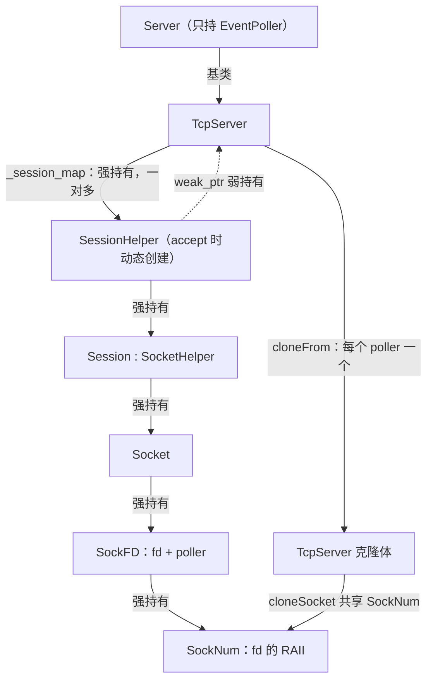
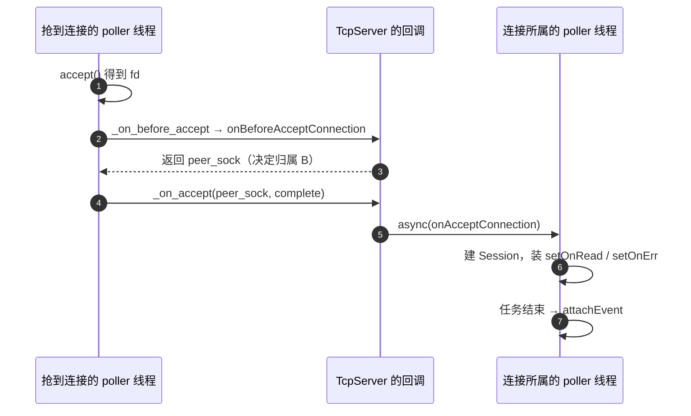

# 模块二・ZLToolKit 基石 第 3 篇：网络层源码精读——Socket 封装、多线程 accept 与 Session 生命周期管理

## 本篇主要讲述内容

1. `SockNum` / `SockFD` / `Socket` 三层对象各自管什么，为什么要把 fd 和线程绑成一个整体；
2. `TcpServer` 怎么用**一条 listen fd** 在 N 条 poller 线程上做抢占式 accept，并把新连接派发到目标线程；
4. `Session` 的生命周期管理与 2 秒一次的全表清扫，`SessionHelper` / `SessionMap` 的分工；

## 关键文件清单（精读重点在前）

| 文件 | 精读重点 |
|---|---|
| `src/Network/Socket.h` | `SockNum` / `SockFD` / `Socket` / `SocketHelper` 四层定义，`SockException` |
| `src/Network/Socket.cpp` | `createSocket` 的自定义 deleter、`attachEvent`、`onRead`、`onAccept`、`cloneSocket`、`moveTo` |
| `src/Network/TcpServer.cpp` | `setupEvent`、`start_l`、`onAcceptConnection`、`onManagerSession` |
| `src/Network/Server.cpp` | `SessionMap`、`SessionHelper` 的注册与注销 |
| `src/Network/Session.h` | `Session`、`SessionWithSSL` |
| `src/Network/sockutil.h` / `sockutil.cpp` | 平台 socket 选项封装（`setNoDelay`、`setNoBlocked`、`setCloseWait` 等） |

## 一、三层对象：谁持有 fd，谁绑定线程，谁承载业务

先看持有关系，这是整个网络层的地基。



三个类的职责边界很清晰：

- **`SockNum`**（`Socket.h`）标识和持有一个 fd 并在析构时 `close`。它的关键性质是**可共享**：`std::shared_ptr<SockNum>` 被多个 `Socket` 共同持有，最后一个引用释放时才真正 close。这正是 `cloneSocket` 能让 N 个 poller 监听同一个 listen fd 而不互相踩的基础。
- **`SockFD`**（`Socket.h`）把 `SockNum` 和 `EventPoller` 绑在一起，析构时调用 `delEvent()`，把 fd 从那条线程的 poller 里删掉。
- **`Socket`** 持有 `SockFD`（通过 `SockFD` 间接持有 `SockNum`），负责业务：回调、发送队列、互斥开关、速率统计；析构时 `SockFD` 会在 poller 线程上自动调用 `delEvent()`，把 fd 从事件表里摘掉。

`Socket` 的构造函数里有一个容易忽略的参数：

```cpp
Socket::Socket(EventPoller::Ptr poller, bool enable_mutex)
    : _poller(std::move(poller))
    , _mtx_sock_fd(enable_mutex)
    , _mtx_event(enable_mutex)
    , _mtx_send_buf_waiting(enable_mutex)
    , _mtx_send_buf_sending(enable_mutex) {
```

`enable_mutex=false` 时四个互斥量全部变成空实现（`MutexWrapper`，`Socket.h`）。服务端的默认选择是**关锁**：监听 fd 的 `_on_create_socket` 默认回调传的是 `false`，accept 出来的子 socket 也传 `false`（`Socket.cpp` 的注释写得很清楚："子 Socket 共用父 Socket 的 poll 线程并且关闭互斥锁"）。只有客户端显式传 `true`。这是单线程场景下省锁的标准做法：**线程归属确定了，就不需要锁**。

## 二、Socket 的线程约束：归属、事件注册与迁移

网络层有一条贯穿始终的约束：**一个 fd（即一个 Socket 对象持有的那个 socket 文件描述符）只属于一条线程**。这条约束不是靠文档约定，而是由三个动作共同落实的——对象在哪条线程析构（2.1）、事件在哪条线程注册（2.2）、连接搬家时 SockFD 怎么重建（2.3）。三者任意一个破了，fd 的线程归属就失效。

### 2.1 析构也必须回 poller 线程

归属不只指"谁跑事件"，还包括"谁负责销毁"：`Socket` 的析构必须回到那条线程。

先搞清楚 `createSocket` 在哪被调、在哪条线程调——两个入口都在 poller 线程上：

| 入口 | 调用链 | 调用线程 |
|------|--------|---------|
| 服务端 accept | epoll `onAccept` 回调 → `_on_before_accept(_poller)` → `createSocket(_poller, false)` | 监听 fd 所属的 poller 线程 |
| 客户端 connect | `TcpClient` 构造时设 `_on_create_socket` → `createSocket(poller, true)` | TcpClient 绑定的 poller 线程 |

Socket构造函数本身只初始化成员变量（绑 poller、设四个互斥量、清零回调），**不碰 fd、不调 epoll_ctl**。fd 是后续 `setSock(SockNum)` 才绑进去的，epoll 事件是 `attachEvent` 才注册的。

```cpp
Socket::Ptr Socket::createSocket(const EventPoller::Ptr &poller_in, bool enable_mutex) {
    auto poller = poller_in ? poller_in : EventPollerPool::Instance().getPoller();
    std::weak_ptr<EventPoller> weak_poller = poller;
    return Socket::Ptr(new Socket(poller, enable_mutex), [weak_poller](Socket *ptr) {
        if (auto poller = weak_poller.lock()) {
            poller->async([ptr]() { delete ptr; });
        } else {
            delete ptr;
        }
    });
}
```

注意这里**重写了 shared_ptr 的 deleter**。**deleter 把 `delete Socket` 投回 poller 线程，让析构与fd事件回调串行，不会一边析构一边跑事件导致并发安全问题。**

用 `weak_ptr` 而不是 `shared_ptr` 捕获 poller，是为了避免"Socket 持有 poller、poller 持有 Socket"的循环引用。

这条规则还有个副作用：**`Socket` 的最后一个引用释放后，对象不会立刻被 delete**，而是排队到下一次 poller 循环。如果代码里依赖"销毁即释放"的时序（比如统计计数），会看到延迟。

### 2.2 事件注册：fd 只能挂在自己的 poller 上

`attachEvent` 有三个调用入口，**全部在 poller 线程上触发**：

| 入口 | 调用链 | 时机 |
|------|--------|------|
| 服务端 accept | `onAccept`（父 Socket 的 epoll 回调）→ `peer_sock`（子Socket 对象）`attachEvent(sock)`（SockNum 对象，持有 fd） | 新连接 accept 出来后、加入 poll 监听前 |
| 客户端 connect | `connect_l` → `attachEvent(sock)` | connect 异步连接成功后 |
| 连接搬家 | `cloneSocket` 的 0x01 自定义 deleter → `attachEvent(sock)` | `moveTo` 重建 SockFD 后 |

三者共同点：**调用线程就是 fd 要归属的那条 poller**，所以 `attachEvent` 里 `_poller->addEvent(fd, ...)` 不会有线程归属错配。

以服务端 accept 的完整路径为例，源码里变量关系一目了然：

```cpp
// onAccept() 内部，Socket.cpp

// 步骤 1：构造空 Socket（C++ 封装，只有 poller 归属，还没有 fd）
peer_sock = Socket::createSocket(_poller, false);    // Socket::Ptr

// 步骤 2：accept() 返回 fd，包成 SockNum（内核 fd 的持有者）
auto sock = std::make_shared<SockNum>(fd, SockNum::Sock_TCP);  // SockNum::Ptr

// 步骤 3：绑定 + 注册 epoll
peer_sock->setSock(sock);       // Socket 通过 _sock_fd 持有 SockNum
peer_sock->attachEvent(sock);   // peer_sock 是主体（this），sock 提供 fd
```

`attachEvent` 只做一件事——把 `sock->rawFd()` 交给 `_poller->addEvent(...)`，其中 `_poller` 就是步骤 1 里传进去的归属线程。它按 socket 类型分两条路：

| 类型 | 监听事件 | 回调 |
|---|---|---|
| `Sock_TCP_Server`（监听 fd） | `Event_Read \| Event_Error` | `onAccept` |
| `Sock_TCP` / `Sock_UDP`（连接 fd） | `Event_Read \| Event_Write \| Event_Error` | `onRead` / `onWriteAble` / `emitErr` |

监听 fd 不挂写事件，因为它永远可写（`accept` 不涉及写）；连接 fd（TCP 和 UDP 都算）挂 `Event_Write`——当接收方太慢导致内核发送缓冲写满时，`write` 会返回 `EAGAIN`，这时候把剩余数据暂存在 Socket 用户态的 `_send_buf_waiting` 队列里，等 `EPOLLOUT` 事件通知"内核缓冲有空位了"再写进去。

还有一个细节：连接 fd 的读缓冲来自 `_poller->getSharedBuffer(...)`——**每条线程共享一份读缓冲**（第 1 篇已讲过 `_shared_buffer[2]`）。所以读回调里拿到的 `Buffer::Ptr` 是线程共享内存，处理完必须放回，不能跨线程持有。这一点在 UDP 那节会成为关键约束。

### 2.3 `moveTo`：已废弃，旧版 accept 派发方案

先澄清：**当前 ZLM 代码不走 `moveTo`**。`TcpServer::setupEvent()` 函数里废弃了 moveTo 分支，accept 阶段负载均衡机制用的是第三节讲的"克隆 server 路由"方案——每个 poller 上提前 clone 一份 TcpServer，accept 出来的子 Socket 归属监听 poller，派发时按 poller 指针找到对应的 cloned server 处理。

但 `moveTo` 这个 API 还留着，`Socket.h` 里也没删。它是旧版多线程 accept 的实现方式，完整调用链：

```cpp
// 旧版方案，TcpServer.cpp
if (_multi_poller) {
    EventPollerPool::Instance().getExecutor([sock, weak_self](const TaskExecutor::Ptr &exe) {
        // getExecutor 从池子 N 条 poller 里选一条负载最低的
        // 回调被投到选中的 poller 上执行，exe 就是那条 poller
        sock->moveTo(static_pointer_cast<EventPoller>(exe));  // 迁归属
        strong_self->getServer(sock->getPoller().get())->onAcceptConnection(sock);
    });
}
```

整条链路：`accept 回调（监听 poller）→ getExecutor 选 poller → cb 投到目标 poller → moveTo`。moveTo 本身就跑在目标 poller 线程上，所以 `delEvent` 和后续 `attachEvent` 线程归属正确。

`moveTo` 源码和内部调用链：

```cpp
void Socket::moveTo(EventPoller::Ptr poller) {
    LOCK_GUARD(_mtx_sock_fd);
    _poller = std::move(poller);                                        // 1. 改归属线程指针
    _sock_fd = std::make_shared<SockFD>(_sock_fd->sockNum(), _poller);  // 2. 重建 SockFD
}
```

整个过程包含：旧 SockFD 析构自动触发（_sock_fd的shared_ptr 替换）→ `~SockFD() { delEvent(); }` → 调 SockFD 内部存的旧 `_poller->delEvent(fd)` → 旧 poller 的 epoll 里删掉这个 fd->新 SockFD 存入新 poller 指针。

为什么新版废弃了 moveTo？因为运行时迁移有 `delEvent → addEvent → 改归属 → 加锁` 的代价，还会有事件丢失窗口。新版提前 clone server 的方案，Socket 归属从始至终不变，派发靠 server 路由，更简单也更安全。

## 三、TcpServer：一条 listen fd，N 条 poller 线程

2.3 末尾说过，新版不再用 `moveTo` 迁移连接，而是提前克隆 server。这一节把它讲透。

先看问题：如果 listen fd 只挂在一条 poller 上，`accept` 和这条连接的读写就都在同一条线程里。多核机器上其余 poller 只能闲着，而短连接多、握手频繁的服务端，`accept` 本身就会成为单线程瓶颈。

ZLToolKit 的做法是让**每条 poller 都持有这份 listen fd**。新连接到达时它们会全部被唤醒，各自去 `accept`，**谁先进入内核谁拿到这条连接**，其余拿到 `EAGAIN` 返回——归属由这次 `accept` 竞争决定。于是有两个问题必须解决：

1. 同一条 listen fd 怎么被多条线程同时监听（3.1）；
2. accept 到的连接若不属于当前线程，怎么安全派发过去、怎么在目标线程装配回调（3.2、3.3）。

### 3.1 `start_l`：建克隆体，把同一个 fd 挂到所有线程

`TcpServer::start<SessionType>` 只做两件事：注册 Session 工厂、调 `start_l`。完整实现如下（`TcpServer.cpp:217-261`），注释标了五步：

```cpp
void TcpServer::start_l(const std::string &type, uint16_t port, const std::string &host, uint32_t backlog) {
    // ① 主 server 先装好自己的 Socket 与回调——setOnBeforeAccept / setOnAccept 都在这里挂
    setupEvent();

    // ② 每 2 秒清扫本线程会话表；_poller 即主 server 的归属线程
    weak_ptr<TcpServer> weak_self = std::static_pointer_cast<TcpServer>(shared_from_this());
    _timer = std::make_shared<Timer>(2.0f, [weak_self]() -> bool {
        auto strong_self = weak_self.lock();
        if (!strong_self) { return false; }
        strong_self->onManagerSession();
        return true;
    }, _poller);

    if (_multi_poller) {
        // ③ 遍历池里所有 poller，给除自己以外的每条线程各建一个克隆体
        EventPollerPool::Instance().for_each([&](const TaskExecutor::Ptr &executor) {
            EventPoller::Ptr poller = static_pointer_cast<EventPoller>(executor);
            if (poller == _poller) { return; }   // 跳过自己：主 server 不进 _cloned_server
            auto &serverRef = _cloned_server[poller.get()];  // key 是裸指针；operator[] 先插空项
            if (!serverRef) {                    // 槽位为空才创建，重复 start 不会重建
                serverRef = onCreatServer(poller);   // 带 deleter：delete 经 poller->async 回到本线程
            }
            if (serverRef) {
                // 拷配置而非拷状态：_main_server=false、_on_create_socket、_session_alloc、
                // _multi_poller、mINI 配置、_parent；内部还会 setupEvent + 建自己的 2 秒 Timer
                serverRef->cloneFrom(*this);
            }
        });
    }

    // ④ 建完克隆体才 listen：失败直接抛，不留下半套结构
    if (!_socket->listen(port, host.c_str(), backlog)) {
        string err = (StrPrinter << "Listen on " << host << " " << port << " failed: " << get_uv_errmsg(true));
        throw std::runtime_error(err);           // 端口被占用 / 权限不足
    }

    // ⑤ 最后把同一个 fd 挂到每条线程：共享 SockNum（同一 fd 号），各自 epoll_ctl 注册
    for (auto &pr: _cloned_server) {
        pr.second->_socket->cloneSocket(*_socket);
    }

    InfoL << "TCP server[" << type << "] listening on [" << host << "]: " << port;
}
```

这个顺序不能换：克隆体要先建好——否则 listen 成功后没有线程在等这条 fd；而 `cloneSocket` 必须放在 `listen` 之后——fd 得先处于监听状态，才能挂进各线程的 epoll。每个克隆体都带自己的 2 秒 Timer，**各自清扫本线程上的会话**。

`start_l` 第 ① 步的 `setupEvent()`（`TcpServer.cpp:27-64`）是后面 3.2、3.3 的入口——它给主 server 的监听 Socket 挂两个回调，正好对应接下来两小节：

```cpp
void TcpServer::setupEvent() {
    _socket = createSocket(_poller);                  // 主 server 的监听 Socket
    weak_ptr<TcpServer> weak_self = std::static_pointer_cast<TcpServer>(shared_from_this());
#if 1
    // ① accept 拿到 fd 之后、_on_accept 之前：允许上层"自定义构造"承载这条新连接的 Socket，并决定它挂哪条线程
    //    返回 nullptr 就走默认：Socket::createSocket(_poller, false)
    _socket->setOnBeforeAccept([weak_self](const EventPoller::Ptr &poller) -> Socket::Ptr {
        if (auto strong_self = weak_self.lock()) {
            return strong_self->onBeforeAcceptConnection(poller);   // → 3.2 展开
        }
        return nullptr;                               // 返回空则用默认：共用父 Socket 的 poller
    });

    // ② accept 之后：按"连接归属哪条线程"找到 3.1 建好的克隆体，把装配任务投过去
    _socket->setOnAccept([weak_self](Socket::Ptr &sock, shared_ptr<void> &complete) {
        if (auto strong_self = weak_self.lock()) {
            auto ptr = sock->getPoller().get();        // 连接归属的 poller
            auto server = strong_self->getServer(ptr); // 查 _cloned_server，命中克隆体，否则回主 server
            ptr->async([server, sock, complete]() {
                server->onAcceptConnection(sock);      // → 3.3：在目标线程装配 Session；complete 随任务传过去，最后一个副本析构时才 attachEvent
            });
        }
    });
#else
    // 旧方案：accept 后用 sock->moveTo(目标 poller) 迁移连接，已被 #if 1 关掉（见 2.3）
#endif
}
```

注意 `getServer(ptr)` 查的正是 3.1 建的那张 `_cloned_server` 表——克隆结构在这里第一次被使用。

`setupEvent` 挂的这两个回调，在运行期的调用顺序就是这样一条线：



读图记三点：cb1 在 `accept()` 拿到 fd **之后**、`_on_accept` **之前**跑，所以能决定归属线程（名字里的 before 是"交给上层之前"）；cb2 在 `_on_accept` 里跑，所以拿得到 `peer_sock`；`attachEvent` 排在装配之后、且落在 B 线程，所以 `onRead` 不会早于回调就绪。后面的 3.2、3.3 就是把这条线拆开讲。

克隆体的析构也被安排在对应 poller 线程里执行（`TcpServer.cpp`）：

```cpp
TcpServer::Ptr TcpServer::onCreatServer(const EventPoller::Ptr &poller) {
    return Ptr(new TcpServer(poller), [poller](TcpServer *ptr) { poller->async([ptr]() { delete ptr; }); });
}
```

和 `Socket::createSocket` 是同一个套路，理由也相同。

这里要澄清一个常见误解：**这套多线程监听不依赖 `SO_REUSEADDR` / `SO_REUSEPORT`**。`cloneSocket` 让克隆体共享同一个 `SockNum`，也就是**同一个 fd 号**；每条 poller 只是各自 `epoll_ctl(EPOLL_CTL_ADD, 同一个 fd)`。同一个 fd 注册进多个 epoll 实例是内核允许的，事件会在每个实例上都上报，跟端口复用选项无关。（真正需要 `SO_REUSEPORT` 的是 UDP 那套：克隆体各自 `bind` 同一端口，本篇不展开。）

代价是惊群：新连接到达时，所有挂了这个 fd 的 poller 都会被唤醒，只有一个 `accept` 成功，其余拿到 `EAGAIN` 直接返回——`Socket::onAccept` 里 `EAGAIN → return 0` 就是按这个前提写的。另外 ZLToolKit 用的是边缘触发（`toEpoll` 默认附加 `EPOLLET`，`EventPoller.cpp:34-37`），而 `EPOLLEXCLUSIVE` 不能与 `EPOLLET` 同时使用（源码里定义了宏但 `toEpoll` 并未使用它，`EventPoller.cpp:28-32`），所以这套实现只能"抢 + `EAGAIN` 兜底"，用不上内核的排他唤醒。

### 3.2 抢占式 accept

3.1 里 `setOnBeforeAccept` 挂的就是下面这个函数。先注意调用时机：`Socket::onAccept` 是**先 `accept()` 拿到 fd、设置好 fd 属性，才调 `_on_before_accept`**。所以名字里的 before 不是"在 `accept()` 之前"，而是"在把连接交给上层之前"——即 `_on_accept` 之前。这个钩子在新 fd 构造 Socket 时介入：上层可替换 Socket 类型与构造参数，并借传入的 `EventPoller` 指定归属线程，决定该连接后续事件挂在哪个 epoll 上。

监听事件挂在所有 poller 上，新连接到达时，它们**全部被唤醒**（没有 `EPOLLEXCLUSIVE`），各自去 `accept`：谁先进内核谁拿到这条连接，其余拿到 `EAGAIN` 返回。这就是"抢占式"——抢的是 `accept`，不是唤醒。真正的难点在后面：**accept 出来的连接应该归哪条线程**。

```cpp
Socket::Ptr TcpServer::onBeforeAcceptConnection(const EventPoller::Ptr &poller) {
    assert(_poller->isCurrentThread());
    return createSocket(_multi_poller ? EventPollerPool::Instance().getPoller(false) : _poller);
}
```

注意这里是 `getPoller(false)`，**明确不要当前线程**。注释原文："此处改成自定义获取 poller 对象，防止负载不均衡"。如果沿用当前线程，那么谁抢到 accept 谁就吃下这个连接，线程之间会越差越多——抢得快的线程会一直抢到，这就是负载倾斜。

于是常见的形态是"**A 线程 accept 到连接，连接却属于 B 线程**"，跨线程派发就此产生。

### 3.3 `onAcceptConnection` 

3.1 的 `setupEvent` 里最后那句 `server->onAcceptConnection(sock)` 就是它。`TcpServer::onAcceptConnection`（`TcpServer.cpp`）做四步：

1. `_session_alloc(server, sock)` 创建 Session 实体并包成 `SessionHelper`（构造时会注册到全局的 `SessionMap`）；
2. `session->attachServer(*this)` 把 `mINI` 配置下发给会话；
3. `_session_map.emplace(helper.get(), helper)` 进本线程的会话表；
4. 给 socket 装两个回调：

```cpp
sock->setOnRead([weak_session](const Buffer::Ptr &buf, struct sockaddr *, int) {
    auto strong_session = weak_session.lock();
    if (!strong_session) { return; }
    try { strong_session->onRecv(buf); }
    catch (SockException &ex) { strong_session->shutdown(ex); }
    catch (exception &ex) { strong_session->shutdown(SockException(Err_shutdown, ex.what())); }
});

sock->setOnErr([weak_self, weak_session, ptr, cls](const SockException &err) {
    onceToken token(nullptr, [&]() {
        // 先执行 onError，再移除会话；即使 onError 抛异常也保证移除
        auto strong_self = weak_self.lock();
        if (!strong_self) { return; }
        if (!strong_self->_is_on_manager) {
            strong_self->_session_map.erase(ptr);
        } else {
            // 正在遍历 _session_map 时不能直接删元素，投到下一轮循环再删
            strong_self->_poller->async([weak_self, ptr]() { ... erase(ptr); }, false);
        }
    });
    auto strong_session = weak_session.lock();
    if (strong_session) { strong_session->onError(err); }
});
```

两个回调分工不同：

- **`setOnRead` 是收数据入口**：`Socket::onRead` 在 poller 线程读到一块数据后调它，这里交给 `session->onRecv(buf)` 做协议解析。异常分两类——`SockException` 当作 Session 主动要求关闭，其他 `std::exception` 包成 `Err_shutdown` 再关，确保回调里抛异常不会打断 poller 事件循环。捕获的是 `weak_session`：Session 已销毁时读到的数据直接丢弃，同时避免 Socket 与 Session 互相持有形成环。
- **`setOnErr` 是收尾**：对端关闭（`onRead` 读到 0 字节即 `Err_eof`）、写失败、`attachEvent` 失败、本地 `shutdown` 都会走到这里。`onceToken` 把顺序固定成"先 `onError` 再 `erase`"——反过来先 erase，`SessionHelper` 析构、`Session` 归零，`onError` 就没机会执行，而业务常在这里发最后一包数据。`erase` 必须发生在持有这张 `_session_map` 的 server 所属线程里；若此刻正遍历该表（`_is_on_manager`），直接删会让迭代器失效，于是改用 `async(..., false)` 排到下一轮——第二个参数 `false` 表示即使同线程也不允许同步执行。

两个回调都只在 poller 线程被调用，所以 `Session::onRecv` / `onError` 串行在会话属主线程上，Session 内部不必为这两条路径加锁。

## 四、Session 生命周期：谁持有、谁来清

引用关系是三层，强弱明确：

| 持有方 | 持有形式 | 作用 |
|---|---|---|
| `TcpServer::_session_map` | `SessionHelper* → shared_ptr` | 强引用，保证本线程的会话活着 |
| `SessionMap`（全局） | `id → weak_ptr<Session>` | 弱引用，只做跨线程查询，不影响对象生命周期 |
| `Socket` 的回调 | `weak_ptr<Session>` | 弱引用，防止 socket 反向持有会话造成环 |

先把这两张表的组织方式说清，它决定了"连接数到底该怎么数"：

- **`TcpServer::_session_map` 是 per-server 的，不是进程唯一**。主 server 一张，`start_l` 里每个克隆体各一张（`TcpServer.h:127`，`unordered_map<SessionHelper *, SessionHelper::Ptr>`）。会话跟着 `getServer(sock->getPoller())` 走，落在哪个 server 就进哪张表——A 线程 10 个、B 线程 10 个，这个服务就是 20 个会话。主 server 那张也可能非空：`getServer` 在 `_cloned_server` 里查不到时直接回主 server（`TcpServer.cpp:287-299`），而 `getPoller(false)` 是轮转取池中任意 poller，会取到主 server 那条。
- **它不加锁**。`emplace` 发生在 `onAcceptConnection`、`erase` 发生在 `setOnErr`，两边都在该 server 所属线程上，天然串行。
- **要跨线程看全局，用全局 `SessionMap`**。它是单例、带 `_mtx_session`（`Server.cpp:55-85`），`for_each_session` 遍历出来的才是所有 server 的会话总和；per-server 的表只适合在该线程内用。
- 表项数近似连接数，但只是瞬态值：对端断开要等 `onErr` 触发，或者被 2 秒清扫移除，读数才会掉下来。

`SessionHelper` 的构造与析构就是注册与注销（`Server.cpp`）：

```cpp
SessionHelper::SessionHelper(const std::weak_ptr<Server> &server, Session::Ptr session, std::string cls) {
    _server = server;
    _session = std::move(session);
    _cls = std::move(cls);
    _session_map = SessionMap::Instance().shared_from_this();
    _identifier = _session->getIdentifier();
    _session_map->add(_identifier, _session);
}

SessionHelper::~SessionHelper() {
    if (!_server.lock()) {
        _session->onError(SockException(Err_other, "Server shutdown"));   // 服务器先死了
    }
    _session_map->del(_identifier);
}
```

`getIdentifier` 用"全局自增序号 + fd"（`Session.cpp`）：

```cpp
static atomic<uint64_t> s_session_index{0};
_id = to_string(++s_session_index) + '-' + to_string(getSock()->rawFD());
```

不用 fd 单独做 id，是因为 fd 会被复用（旧连接关闭、新连接拿到同一个 fd），会撞 id。

### 定时清扫：`onManagerSession` 负责分发，`Session::onManager` 负责判定

`TcpServer` 在 `start_l` 里就挂了定时器（`TcpServer.cpp`，克隆体在 `cloneFrom` 里同样挂一个）：

```cpp
_timer = std::make_shared<Timer>(2.0f, [weak_self]() -> bool {
    auto strong_self = weak_self.lock();
    if (!strong_self) { return false; }
    strong_self->onManagerSession();
    return true;
}, _poller);
```

`onManagerSession` 用 `onceToken` 标记"正在清扫"，然后遍历本线程会话表（`TcpServer.cpp`）：

```cpp
onceToken token([&]() { _is_on_manager = true; }, [&]() { _is_on_manager = false; });
for (auto &pr : _session_map) {
    try { pr.second->session()->onManager(); }
    catch (exception &ex) { WarnL << ex.what(); }
}
```

`_is_on_manager` 就是 3.3 节 `setOnErr` 里那个分支的开关：清扫期间触发的 `onErr` 不会直接删表，而是排队到下一轮。**遍历容器时不能改容器**，这个约束在网络层是被认真处理过的。

`onManagerSession` 本身只做分发，不做任何判定：`onManager()` 在 ZLToolKit 里是纯虚函数（`Socket.h:1092`，`virtual void onManager() = 0;`），由具体会话实现。一句话概括——**`onManagerSession` 是"每 2 秒把心跳事件批量转发给本线程所有会话"的入口，超时判定、关闭动作都在各 `Session` 自己的 `onManager` 里。**

ZLM 里这个钩子的典型用途是按空闲时长关闭会话（`RtspSession.cpp:94`）：

```cpp
void RtspSession::onManager() {
    GET_CONFIG(uint32_t, handshake_sec, Rtsp::kHandshakeSecond);
    GET_CONFIG(uint32_t, keep_alive_sec, Rtsp::kKeepAliveSecond);

    if (_alive_ticker.createdTime() > handshake_sec * 1000) {
        // 连上来后迟迟不发 RTSP 请求，也还没拿到 sessionid：握手超时
        if (_sessionid.size() == 0) {
            shutdown(SockException(Err_timeout, "illegal connection"));
            return;
        }
    }

    if (_push_src && _alive_ticker.elapsedTime() > keep_alive_sec * 1000) {
        // 已注册推流器但长时间没有数据：推流超时
        shutdown(SockException(Err_timeout, "pusher session timeout"));
        return;
    }

    if (!_push_src && _rtp_type == Rtsp::RTP_UDP && _alive_ticker.elapsedTime() > keep_alive_sec * 4000) {
        // RTP over UDP 的播放器不发 RTSP 心跳，超时阈值放宽到 4 倍：播放器超时
        shutdown(SockException(Err_timeout, "rtp over udp player timeout"));
    }
}
```

两处值得注意：

- `_alive_ticker` 在 `onRecv` 里 `resetTime()`（`RtspSession.cpp:118`），所以这里的超时是**空闲超时**，不是从建连算起的绝对时长；`createdTime()` 判的是"建立到现在多久没完成握手"。
- `shutdown` 会走会话自己的关闭流程，最终落到 `setOnErr` 里的 `erase`——正是上面说的"清扫期间删表要排队"的场景。定时器与 `onErr` 就是在这里接上的。

`WebSocketSession` 同理：先转发给内部会话，再检查 `_recv_ticker` 是否超过 30 秒（`WebSocketSession.h:114`）。

## 五、常见问题排查

### 问题 1：跨线程直接调用 `socket->send()` / `shutdown()`

现象：偶发崩溃在 `flushData` 或 `closeSock`，堆栈看起来毫无关联；或者数据发出去但对方收不到。

原因：`Socket` 的所有状态都默认"只有归属线程会访问"。`enable_mutex=false` 的连接（accept 出来的子 socket 默认就是）没有任何锁保护，跨线程调用等于直接竞争。

正确做法是投递到它的 poller：

```cpp
sock->getPoller()->async([sock, buf]() { sock->send(buf); });
```

`SocketHelper::async` 已经封好了这件事（`Socket.h`），Session 层直接 `session->async(...)` 即可。

### 问题 2：accept 之后事件再也不来

现象：连接建立了，`onAccept` 也触发，但 `onRead` 永远不来。

原因有两类，都发生在边缘触发下：

- `accept` 只循环一次就返回，没读到 `EAGAIN`，内核不再上报新事件。`Socket::onAccept` 用的是 `while (true)` 循环，直到 `accept` 返回 `EAGAIN`（`Socket.cpp`）；
- fd 耗尽（`EMFILE`/`ENFILE`）。此时 `accept` 失败且不是 `EAGAIN`，代码用 `doDelayTask(100ms)` 手动重试（`Socket.cpp`），因为边缘触发下手动触发是唯一办法；`wepoll`（Windows）不支持边缘触发，走的是 `sleep 10ms` 的水平触发分支。

排查时先看日志里有没有 `Accept socket failed`，再看 `ulimit -n`。

## 下一篇预告

网络层讲完，下一个要解决的问题是"数据怎么放"：一条 1080p 视频流每秒产生几十个 buffer，每个都 `new` 一次是什么代价？下一篇拆**内存管理**——`Buffer` / `BufferRaw` / `BufferList` 的对象池、引用计数、零拷贝边界，以及 ZLM 里 `jemalloc` / `tcmalloc` 的切换与实测差异。
