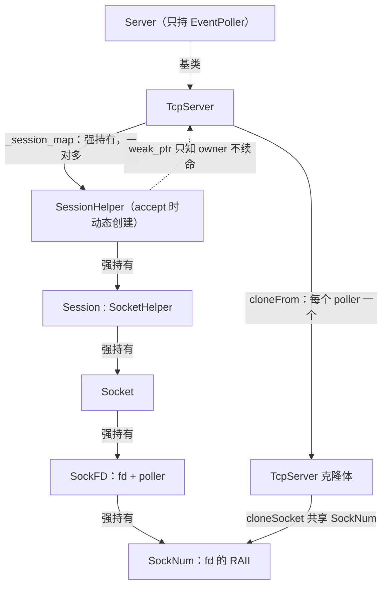
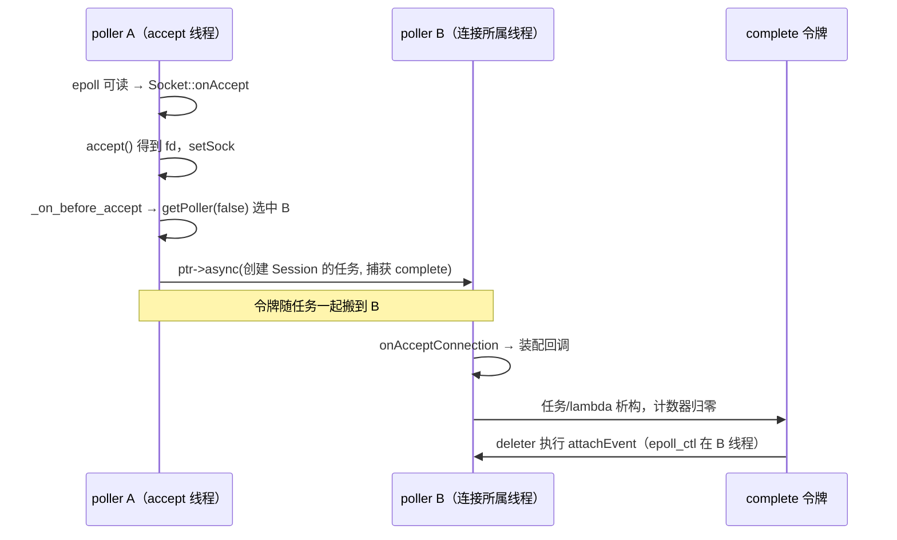
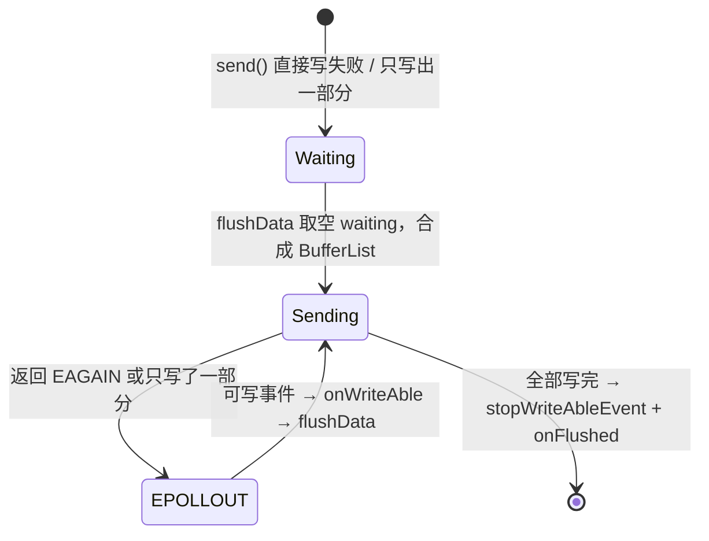

# 模块二・ZLToolKit 基石 第 3 篇：网络层源码精读——Socket 封装、Session 模式与多线程 accept

## 本篇主要讲述内容

1. `SockNum` / `SockFD` / `Socket` 三层对象各自管什么，为什么要把 fd 和线程绑成一个整体；
2. `TcpServer` 怎么用**一条 listen fd** 在 N 条 poller 线程上做抢占式 accept，并把新连接派发到目标线程；
3. 发送路径的两级缓冲与 `EPOLLOUT` 背压：`send` 里发生了什么，什么时候才会挂可写事件；
4. `UdpServer` 怎么用**一个 fd** 收所有对端的数据，按 18 字节的 peer id 分会话，以及"数据漂移"怎么检测；
5. `Session` 的生命周期管理与 2 秒一次的全表清扫，`SessionHelper` / `SessionMap` 的分工；
6. `SessionWithSSL` / `SessionWithKCP` 这两个模板，如何在不改 Session 逻辑的前提下给会话套上 TLS / KCP；
7. `TcpClient` 的重连为什么必须做"旧 socket 事件隔离"。

## 关键文件清单（精读重点在前）

| 文件 | 精读重点 |
|---|---|
| `src/Network/Socket.h` | `SockNum` / `SockFD` / `Socket` / `SocketHelper` 四层定义，`SockException` |
| `src/Network/Socket.cpp` | `createSocket` 的自定义 deleter、`attachEvent`、`onRead`、`onAccept`、`flushData`、`cloneSocket`、`moveTo` |
| `src/Network/TcpServer.cpp` | `setupEvent`、`start_l`、`onAcceptConnection`、`onManagerSession` |
| `src/Network/TcpClient.h` / `TcpClient.cpp` | `startConnect`、连接回调、旧 socket 事件隔离 |
| `src/Network/Server.cpp` | `SessionMap`、`SessionHelper` 的注册与注销 |
| `src/Network/Session.h` | `Session`、`SessionWithSSL`、`SessionWithKCP` |
| `src/Network/UdpServer.cpp` | `onRead_l` 的线程漂移处理、`onManagerSession` 按 poller 过滤 |
| `src/Network/Kcp.h` / `Kcp.cpp` | `KcpHeader`、`KcpPacket`、`KcpTransport::input` 与 `startTimer` |
| `src/Network/sockutil.h` / `sockutil.cpp` | 平台 socket 选项封装（`setNoDelay`、`setNoBlocked`、`setCloseWait` 等） |

## 一、三层对象：谁持有 fd，谁绑定线程，谁承载业务

先看持有关系，这是整个网络层的地基。



三个类的职责边界很清晰：

- **`SockNum`**（`Socket.h`）标识和持有一个 fd 并在析构时 `close`。它的关键性质是**可共享**：`std::shared_ptr<SockNum>` 被多个 `Socket` 共同持有，最后一个引用释放时才真正 close。这正是 `cloneSocket` 能让 N 个 poller 监听同一个 listen fd 而不互相踩的基础。
- **`SockFD`**（`Socket.h`）把 `SockNum` 和 `EventPoller` 绑在一起，析构时调用 `delEvent()`，把 fd 从那条线程的 poller 里删掉。
- **`Socket`** 持有 `SockFD`（通过 `SockFD` 间接持有 `SockNum`），负责业务：回调、发送队列、互斥开关、速率统计；析构时 `SockFD` 会在 poller 线程上自动调用 `delEvent()`，把 fd 从事件表里摘掉。

`Socket` 的构造函数里有一个容易忽略的参数：

```cpp
Socket::Socket(EventPoller::Ptr poller, bool enable_mutex)
    : _poller(std::move(poller))
    , _mtx_sock_fd(enable_mutex)
    , _mtx_event(enable_mutex)
    , _mtx_send_buf_waiting(enable_mutex)
    , _mtx_send_buf_sending(enable_mutex) {
```

`enable_mutex=false` 时四个互斥量全部变成空实现（`MutexWrapper`，`Socket.h`）。服务端的默认选择是**关锁**：监听 fd 的 `_on_create_socket` 默认回调传的是 `false`，accept 出来的子 socket 也传 `false`（`Socket.cpp` 的注释写得很清楚："子 Socket 共用父 Socket 的 poll 线程并且关闭互斥锁"）。只有客户端显式传 `true`。这是单线程场景下省锁的标准做法：**线程归属确定了，就不需要锁**。

## 二、Socket 的线程约束：归属、事件注册与迁移

网络层有一条贯穿始终的约束：**一个 fd 只属于一条线程**。这条约束不是靠文档约定，而是由三个动作共同落实的——对象在哪条线程析构（2.1）、事件在哪条线程注册（2.2）、连接搬家时 SockFD 怎么重建（2.3）。三者任意一个破了，fd 的线程归属就失效。

### 2.1 析构也必须回 poller 线程

归属不只指"谁跑事件"，还包括"谁负责销毁"：`Socket` 的析构必须回到那条线程。

```cpp
Socket::Ptr Socket::createSocket(const EventPoller::Ptr &poller_in, bool enable_mutex) {
    auto poller = poller_in ? poller_in : EventPollerPool::Instance().getPoller();
    std::weak_ptr<EventPoller> weak_poller = poller;
    return Socket::Ptr(new Socket(poller, enable_mutex), [weak_poller](Socket *ptr) {
        if (auto poller = weak_poller.lock()) {
            poller->async([ptr]() { delete ptr; });
        } else {
            delete ptr;
        }
    });
}
```

注意这里**重写了 shared_ptr 的 deleter**。**deleter 把 `delete Socket` 投回 poller 线程，让析构与fd事件回调串行，不会一边析构一边跑事件导致并发安全问题。**

用 `weak_ptr` 而不是 `shared_ptr` 捕获 poller，是为了避免"Socket 持有 poller、poller 持有 Socket"的循环引用。

这条规则还有个副作用：**`Socket` 的最后一个引用释放后，对象不会立刻被 delete**，而是排队到下一次 poller 循环。如果代码里依赖"销毁即释放"的时序（比如统计计数），会看到延迟。

### 2.2 事件注册：fd 只能挂在自己的 poller 上

`attachEvent` 只做一件事——把 fd 交给 `_poller->addEvent(...)`，而 `_poller` 就是归属线程。fd 挂在哪条线程的 epoll 上，就只会在那条线程被回调。它按 socket 类型分两条路：

| 类型 | 监听事件 | 回调 |
|---|---|---|
| `Sock_TCP_Server`（监听 fd） | `Event_Read \| Event_Error` | `onAccept` |
| `Sock_TCP` / `Sock_UDP`（连接 fd） | `Event_Read \| Event_Write \| Event_Error` | `onRead` / `onWriteAble` / `emitErr` |

监听 fd 不挂写事件，因为它永远可写（`accept` 不涉及写）；连接 fd（TCP 和 UDP 都算）挂 `Event_Write`——当接收方太慢导致内核发送缓冲写满时，`write` 会返回 `EAGAIN`，这时候把剩余数据暂存在 Socket 用户态的 `_send_buf_waiting` 队列里，等 `EPOLLOUT` 事件通知"内核缓冲有空位了"再写进去。第五节会详细讲这套两级缓冲的背压机制。

还有一个细节：连接 fd 的读缓冲来自 `_poller->getSharedBuffer(...)`——**每条线程共享一份读缓冲**（第 1 篇已讲过 `_shared_buffer[2]`）。所以读回调里拿到的 `Buffer::Ptr` 是线程共享内存，处理完必须放回，不能跨线程持有。这一点在 UDP 那节会成为关键约束。

### 2.3 `moveTo`：把连接搬到另一条线程

```cpp
void Socket::moveTo(EventPoller::Ptr poller) {
    LOCK_GUARD(_mtx_sock_fd);
    if (poller) {
        _poller = std::move(poller);
    }
    if (_sock_fd) {
        _sock_fd = std::make_shared<SockFD>(_sock_fd->sockNum(), _poller);
    }
}
```

搬家的方式很干脆：把 `_poller` 换掉，再用同一个 `SockNum` 重建 `SockFD`。旧的 `SockFD` 析构 → 在**旧线程** `delEvent`；新的 `SockFD` 构造 → 在**新线程** `addEvent`。

但要注意：`moveTo` 必须在旧线程调用（`delEvent` 是线程敏感的），而且换完之后要在新线程重新 `attachEvent`。所以这个方法更适合"在创建阶段就把连接分配好"，而不是运行中随意迁移。

## 三、TcpServer：一条 listen fd，N 条 poller 线程

### 3.1 克隆结构

`TcpServer::start<SessionType>` 只做两件事：注册 Session 工厂、调 `start_l`。真正的结构在 `start_l`（`TcpServer.cpp`）：

```cpp
if (_multi_poller) {
    EventPollerPool::Instance().for_each([&](const TaskExecutor::Ptr &executor) {
        EventPoller::Ptr poller = static_pointer_cast<EventPoller>(executor);
        if (poller == _poller) { return; }                 // 自己的那条线程跳过
        auto &serverRef = _cloned_server[poller.get()];
        if (!serverRef) { serverRef = onCreatServer(poller); }  // 每条线程一个 TcpServer
        if (serverRef) { serverRef->cloneFrom(*this); }
    });
}

if (!_socket->listen(port, host.c_str(), backlog)) { throw ...; }

for (auto &pr: _cloned_server) {
    pr.second->_socket->cloneSocket(*_socket);   // 同一个 listen fd 挂到每条线程
}
```

关键顺序：**先建克隆体、后 listen、最后 cloneSocket**。`cloneFrom`（`TcpServer.cpp`）会把 `_session_alloc`、`_on_create_socket`、`mINI` 配置、`_parent` 指针全部拷过去，并给克隆体挂上自己的 2 秒 Timer——**每个克隆体都独立清扫自己线程上的会话**。

克隆体的析构也被安排在对应 poller 线程里执行（`TcpServer.cpp`）：

```cpp
TcpServer::Ptr TcpServer::onCreatServer(const EventPoller::Ptr &poller) {
    return Ptr(new TcpServer(poller), [poller](TcpServer *ptr) { poller->async([ptr]() { delete ptr; }); });
}
```

和 `Socket::createSocket` 是同一个套路，理由也相同。

### 3.2 抢占式 accept 与 `getPoller(false)`

监听事件挂在所有 poller 上，谁被唤醒谁就 accept——这就是"抢占式"。真正的难点是：**accept 出来的连接应该归哪条线程**。

```cpp
Socket::Ptr TcpServer::onBeforeAcceptConnection(const EventPoller::Ptr &poller) {
    assert(_poller->isCurrentThread());
    return createSocket(_multi_poller ? EventPollerPool::Instance().getPoller(false) : _poller);
}
```

注意这里是 `getPoller(false)`，**明确不要当前线程**。注释原文："此处改成自定义获取 poller 对象，防止负载不均衡"。如果沿用当前线程，那么谁抢到 accept 谁就吃下这个连接，线程之间会越差越多——抢得快的线程会一直抢到，这就是负载倾斜。

于是常见的形态是"**A 线程 accept 到连接，连接却属于 B 线程**"，跨线程派发就此产生。

### 3.3 `complete` 令牌：为什么 `attachEvent` 要延迟

这是本篇最需要看懂的一段，`Socket::onAccept`（`Socket.cpp`）里的写法：

```cpp
auto sock = std::make_shared<SockNum>(fd, SockNum::Sock_TCP);
peer_sock->setSock(sock);                        // 先在 Socket 上记好 fd

shared_ptr<void> completed(nullptr, [peer_sock, sock](void *) {
    try {
        // 把 fd 加入 poll 监听（确保先触发 onAccept 事件、再触发 onRead）
        if (!peer_sock->attachEvent(sock)) {
            peer_sock->emitErr(SockException(Err_eof, "add event to poller failed ..."));
        }
    } catch (std::exception &ex) { ErrorL << ...; }
});

LOCK_GUARD(_mtx_event);
_on_accept(peer_sock, completed);                // 把令牌交给上层
```

`shared_ptr<void>` 的 deleter 是空的，但它是一个**引用计数令牌**：谁捕获它，谁就决定 `attachEvent` 什么时候执行。

上层 `TcpServer::setupEvent`（`TcpServer.cpp`）这样用它：

```cpp
_socket->setOnAccept([weak_self](Socket::Ptr &sock, shared_ptr<void> &complete) {
    if (auto strong_self = weak_self.lock()) {
        auto ptr = sock->getPoller().get();               // 这条连接归属哪条线程
        auto server = strong_self->getServer(ptr);        // 找那条线程上的克隆 TcpServer
        ptr->async([server, sock, complete]() {
            server->onAcceptConnection(sock);             // 在目标线程创建 Session
        });                                               // 任务结束，complete 析构
    }
});
```

时序就闭合了：



这就解释了为什么不能在 A 线程直接 `addEvent`：`epoll_ctl` 必须发生在 fd 所属的那条线程上。**令牌不是给生命周期用的，是给线程用的**——它把 `attachEvent` 精确推迟到"任务已经在目标线程执行完"的那一刻。

### 3.4 `onAcceptConnection` 装配了什么

`TcpServer::onAcceptConnection`（`TcpServer.cpp`）做四步：

1. `_session_alloc(server, sock)` 创建 Session 实体并包成 `SessionHelper`（构造即注册到全局 `SessionMap`，见第八节）；
2. `session->attachServer(*this)` 把 `mINI` 配置下发给会话；
3. `_session_map.emplace(helper.get(), helper)` 进本线程的会话表；
4. 给 socket 装两个回调：

```cpp
sock->setOnRead([weak_session](const Buffer::Ptr &buf, struct sockaddr *, int) {
    auto strong_session = weak_session.lock();
    if (!strong_session) { return; }
    try { strong_session->onRecv(buf); }
    catch (SockException &ex) { strong_session->shutdown(ex); }
    catch (exception &ex) { strong_session->shutdown(SockException(Err_shutdown, ex.what())); }
});

sock->setOnErr([weak_self, weak_session, ptr, cls](const SockException &err) {
    onceToken token(nullptr, [&]() {
        // 先执行 onError，再移除会话；即使 onError 抛异常也保证移除
        auto strong_self = weak_self.lock();
        if (!strong_self) { return; }
        if (!strong_self->_is_on_manager) {
            strong_self->_session_map.erase(ptr);
        } else {
            // 正在遍历 _session_map 时不能直接删元素，投到下一轮循环再删
            strong_self->_poller->async([weak_self, ptr]() { ... erase(ptr); }, false);
        }
    });
    auto strong_session = weak_session.lock();
    if (strong_session) { strong_session->onError(err); }
});
```

两个设计点：

- **`onceToken` 保证"先 onError 再 erase"**。如果先 erase，`SessionHelper` 析构、`Session` 引用归零，`onError` 就没机会跑了；而 `onError` 里用户代码可能还要发最后一包数据。
- **`_is_on_manager` 判断**。`onManagerSession` 正在遍历 `_session_map` 时，某个会话超时会把 `onErr` 同步触发，此时直接 `erase` 会让遍历失效。所以改成 `async(..., false)` 投递到下一轮循环——注意第二个参数 `false` 表示**即使同线程也不允许同步执行**，必须排队。

## 四、`TcpClient`：客户端真正的难点是重连

服务端处理"很多连接"，客户端处理"一条连接的生死"。这个差异直接体现在 `enable_mutex` 的默认值上：

```cpp
TcpClient::TcpClient(const EventPoller::Ptr &poller) : SocketHelper(nullptr) {
    setPoller(poller ? poller : EventPollerPool::Instance().getPoller());
    setOnCreateSocket([](const EventPoller::Ptr &poller) {
        // TCP 客户端默认开启互斥锁
        return Socket::createSocket(poller, true);
    });
}
```

`true`——客户端默认开锁。因为客户端的 socket 通常被业务层从任意线程调用（主动 `send`、主动 `shutdown`），不像服务端的子 socket 只有一个读事件的入口。服务端求吞吐、客户端求安全，这个默认值的选择是场景驱动的。

连接流程在 `startConnect`（`TcpClient.cpp`），三步：

```cpp
_timer = std::make_shared<Timer>(2.0f, ... onManager() ..., getPoller());  // 心跳/超时定时器
setSock(createSocket());                                                   // 建 Socket
sock_ptr->connect(url, port, cb, timeout_sec, _net_adapter, local_port);   // 异步连接
```

`connect` 是**异步的、带超时**的（`timeout_sec` 透传给 `Socket::connect`，内部靠 `doDelayTask` 判定超时），所以 `startConnect` 返回时连接还没建立，结果通过回调到达。

真正值得看的是每个回调里的这一句：

```cpp
if (sock_ptr != strong_self->getSock().get()) {
    // 已经重连 socket，上次的 socket 的事件忽略掉
    return;
}
```

`sock_ptr` 是回调创建时抓取的裸指针。重连后 `getSock()` 返回的是新对象，两者不等，说明这是**上一条连接**的残余事件。`onErr`、`onRead`、`onFlush` 三处都做了这个判断。

不做会怎样：旧连接的超时/断开会触发 `onError`，业务层看到"连接断了"于是再重连一次，而新连接其实是好的——一次网络抖动演变成连环重连。这类"陈旧回调污染新状态"的问题，在所有带重连的客户端代码里都会出现，ZLToolKit 用裸指针比对解决，成本极低。

`alive()` 也为此做了兼容（`TcpClient.cpp`）：正常情况下 `_timer` 非空即算活着，但 WebSocket 客户端场景里 `_timer` 一直为空，所以补了一条"fd 有效也算活着"的判断。

## 五、发送路径：两级缓冲 + `EPOLLOUT` 背压

`send` 的入口很薄，核心全在 `flushData`（`Socket.cpp`）。它维护两个队列：

- `_send_buf_waiting`：一级缓冲，还没尝试写的数据；
- `_send_buf_sending`：二级缓冲，已经写了但没写完的数据。



几个必须理解的细节：

**1）用 `BufferList` 合并成一次写**（`Socket.cpp`）：

```cpp
send_buf_sending_tmp.emplace_back(BufferList::create(std::move(_send_buf_waiting), std::move(send_result), sock->type() == SockNum::Sock_UDP));
```

`BufferList` 不是"包一层循环"那么简单，它按平台和协议选实现：

- **TCP**：`BufferSendMsg`（`BufferSock.cpp`）把整个队列整理成一个 `iovec` 数组，一次 `sendmsg` 提交（Windows 上是 `WSASend`），`IOV_MAX`（通常 1024）截断；
- **UDP（Linux）**：`BufferSendMMsg`（`BufferSock.cpp`）用 `sendmmsg` 一次批量提交多个报文，每个报文保留各自的消息边界；
- **UDP（其它平台）**：退回逐包 `sendto`。

音视频场景里"一帧拆成多个小 buffer"极常见，一帧 1080p 视频可能有几十个 slice buffer，这个合并直接决定 syscall 次数——从几十次降到一次。

**2）`poller_thread` 参数决定要不要挂可写事件**（`Socket.cpp`）：

```cpp
if (!poller_thread) { startWriteAbleEvent(sock); }
```

含义是：如果这次 `flushData` 是 poller 线程里被可写事件触发的，说明可写事件已经在监听中，不需要重复 `epoll_ctl`；如果是业务线程调 `send` 触发的，才需要主动挂上 `EPOLLOUT`，让 poller 稍后来帮忙写完。这个判断避免了每次 `send` 都做一次 `epoll_ctl`。

**3）发完之后递归再 flush 一次**（`Socket.cpp`）：

```cpp
return poller_thread ? flushData(sock, poller_thread) : true;
```

因为 poller 线程在写数据期间，其它线程可能又 `send` 了新数据到 `_send_buf_waiting`，再试一轮能减少一次事件循环往返。

**4）TCP 和 UDP 的错误处理不同**（`Socket.cpp`）：UDP 发送失败直接丢包并 `WarnL`（UDP 本来就不保证送达）；TCP 失败则 `emitErr` 通知上层。这条差异在弱网下会直接影响日志噪音。

## 六、`UdpServer`：一个 fd 收所有对端

UDP 没有连接概念，服务端只有一个 fd，所有客户端的数据都从它进来。ZLToolKit 的分法是：**按对端地址分会话**。

```cpp
class PeerIdType : public std::array<char, 18> {   // C++17
public:
    bool operator==(const PeerIdType &that) const {
        return as<uint64_t>(0) == that.as<uint64_t>(0) &&
               as<uint64_t>(8) == that.as<uint64_t>(8) &&
               as<uint16_t>(16) == that.as<uint16_t>(16);
    }
};
```

18 字节正好覆盖 `sockaddr_in6` 需要的字段（IPv6 地址 16 字节 + 端口 2 字节），比较退化成三次整数比较，比逐字节 `memcmp` 快，也适合做哈希键（`PeerIdHash`，`UdpServer.h`）。

`start_l`（`UdpServer.cpp`）的结构和 TCP 类似但有两处关键差异：

**1）Session 表只有主 server 持有，克隆体共享同一个**

```cpp
_session_mutex = std::make_shared<std::recursive_mutex>();
_session_map = std::make_shared<SessionMapType>();
```

因为 UDP 的会话天然是"跨线程"的：同一个对端的数据可能落到不同 fd（不同线程）。所以表必须共享，且用递归锁保护（`onRead_l` 里会先查表、再可能建会话，建会话又会进表，普通锁会自锁）。

**2）克隆体不是 `cloneSocket`，而是各自 `bindUdpSock`**

```cpp
#if 0
    pr.second->_socket->cloneSocket(*_socket);
#else
    // 实验发现 cloneSocket 方式虽然可以节省 fd 资源，但是在某些系统上线程漂移问题更严重
    pr.second->_socket->bindUdpSock(_socket->get_local_port(), _socket->get_local_ip());
#endif
```

这是**用实测换掉了一个看起来更优雅的方案**：共享 fd 省资源，但会让内核把数据分给哪条线程变得不可控（"线程漂移"）。改成每个线程各自 bind 同一端口（依赖 `SO_REUSEADDR/SO_REUSEPORT`），由内核按 fd 分流，漂移反而更可控。

### 数据漂移的处理

即使各自 bind，也挡不住"数据来了但会话不在这条线程"。`onRead_l`（`UdpServer.cpp`）的处理很有代表性：

```cpp
if (helper->session()->getPoller()->isCurrentThread()) {
    emitSessionRecv(helper, buf);                 // 同线程，直接回调
} else {
    WarnL << "UDP packet incoming from other thread";
    // 读 buffer 是本线程所有 socket 共享复用的，不能跨线程使用，必须先转移走
    auto cacheable_buf = std::move(buf);
    helper->session()->async([weak_helper, cacheable_buf]() {
        if (auto strong_helper = weak_helper.lock()) {
            emitSessionRecv(strong_helper, cacheable_buf);
        }
    });
}
```

两个要点：

- 判断依据是 `session()->getPoller()->isCurrentThread()`，不是"这个 socket 属于谁"；
- 跨线程时必须**先把共享读缓冲的内容搬走**（`std::move(buf)` 后按值捕获），因为那条共享缓冲随时会被本线程的下一次 `read` 覆盖。

这正是第二节埋下的那条约束在 UDP 上的体现：**共享读缓冲 = 不能在别的线程继续用**。

## 七、KCP：把可靠传输套进 Session 模板

KCP 在 ZLToolKit 里不是独立的一套网络栈，而是**挂在 UDP Session 之上的一层状态机**。

协议头固定 24 字节（`Kcp.h`），ZLM 对标准 KCP 头做了一个字段替换——把原来的 `fec`（FEC 相关）位置换成了 `len`，其余字段保持兼容：

```cpp
class KcpHeader {
    static const size_t HEADER_SIZE = 24;
    enum class Cmd : uint8_t {
        CMD_PUSH = 81,  // 数据
        CMD_ACK  = 82,  // 确认
        CMD_WASK = 83,  // 窗口探测
        CMD_WINS = 84,  // 窗口通告
    };
    // conv / cmd / frg / wnd / ts / sn / una / len（ZLM 独有替换）
};
```

派生出四类包：`KcpDataPacket`、`KcpAckPacket`、`KcpProbePacket`（对应 `CMD_WASK`）、`KcpTellPacket`（对应 `CMD_WINS`）（`Kcp.h`）。

`KcpTransport` 是核心，接口很小：

```cpp
void setOnRead(onReadCB cb);
void setOnWrite(onWriteCB cb);
void setOnErr(OnErr cb);
ssize_t send(const Buffer::Ptr &buf, bool flush = false);
void input(const Buffer::Ptr &buf);
```

它在两个方向上对接：

- **下行**：`input()` 收到 UDP 原始报文 → 解析成 `KcpPacket` → 进接收队列 → `update()` 组装成完整帧 → `onRead()` 上抛；
- **上行**：`send()` 进发送队列 → `update()` 按窗口和 RTO 发出去 → `onWrite()` 交给 UDP 发送。

驱动靠一个定时器（`Kcp.cpp`）：

```cpp
float interval = float(_interval) / 1000.0;
_timer = std::make_shared<Timer>(interval, [weak_self]() -> bool {
    auto strong_self = weak_self.lock();
    if (!strong_self) { return false; }
    strong_self->update();      // 超时重传、窗口推进、ACK 都在这
    return true;
}, _poller);
```

注意 `input()` 里还做了一次 `_poller->async(...)`（`Kcp.cpp`）：因为 UDP 共享 fd，报文可能在别的线程被收到，解析必须回到 KCP 归属的线程。

套用方式就是一个模板（`Session.h`）：

```cpp
template <typename SessionType>
class SessionWithKCP : public SessionType {
public:
    void onRecv(const Buffer::Ptr &buf) override { _kcp_box->input(buf); }
protected:
    ssize_t send(Buffer::Ptr buf) override { return _kcp_box->send(std::move(buf)); }
private:
    KcpTransport::Ptr _kcp_box;
};
```

只覆写 `onRecv` 和 `send` 两个点，其余（超时、管理、异常、生命周期）全部沿用 `Session`。`SessionWithSSL` 用的是同一个手法，只是把 `KcpTransport` 换成了 `SSL_Box`（`Session.h`）。这个设计的好处很直接：**加一种传输层协议，不需要动网络层，只需要动一个模板参数**。

## 八、Session 生命周期：谁持有、谁来清

引用关系是三层，强弱明确：

| 持有方 | 持有形式 | 作用 |
|---|---|---|
| `TcpServer::_session_map` | `SessionHelper* → shared_ptr` | 强引用，保证本线程的会话活着 |
| `SessionMap`（全局） | `id → weak_ptr<Session>` | 弱引用，只做跨线程查询，不续命 |
| `Socket` 的回调 | `weak_ptr<Session>` | 弱引用，防止 socket 反向持有会话造成环 |

`SessionHelper` 的构造与析构就是注册与注销（`Server.cpp`）：

```cpp
SessionHelper::SessionHelper(const std::weak_ptr<Server> &server, Session::Ptr session, std::string cls) {
    _server = server;
    _session = std::move(session);
    _cls = std::move(cls);
    _session_map = SessionMap::Instance().shared_from_this();
    _identifier = _session->getIdentifier();
    _session_map->add(_identifier, _session);
}

SessionHelper::~SessionHelper() {
    if (!_server.lock()) {
        _session->onError(SockException(Err_other, "Server shutdown"));   // 服务器先死了
    }
    _session_map->del(_identifier);
}
```

`getIdentifier` 用"全局自增序号 + fd"（`Session.cpp`）：

```cpp
static atomic<uint64_t> s_session_index{0};
_id = to_string(++s_session_index) + '-' + to_string(getSock()->rawFD());
```

不用 fd 单独做 id，是因为 fd 会被复用（旧连接关闭、新连接拿到同一个 fd），会撞 id。

### 2 秒清扫

`TcpServer` 在 `start_l` 里就挂了定时器（`TcpServer.cpp`，克隆体在 `cloneFrom` 里同样挂一个）：

```cpp
_timer = std::make_shared<Timer>(2.0f, [weak_self]() -> bool {
    auto strong_self = weak_self.lock();
    if (!strong_self) { return false; }
    strong_self->onManagerSession();
    return true;
}, _poller);
```

`onManagerSession` 用 `onceToken` 标记"正在清扫"，然后遍历本线程会话表（`TcpServer.cpp`）：

```cpp
onceToken token([&]() { _is_on_manager = true; }, [&]() { _is_on_manager = false; });
for (auto &pr : _session_map) {
    try { pr.second->session()->onManager(); }
    catch (exception &ex) { WarnL << ex.what(); }
}
```

`_is_on_manager` 就是 3.4 节 `setOnErr` 里那个分支的开关：清扫期间触发的 `onErr` 不会直接删表，而是排队到下一轮。**遍历容器时不能改容器**，这个约束在网络层是被认真处理过的。

UDP 的清扫还多一层过滤（`UdpServer.cpp`）：先把共享表拷一份，再按 `getPoller()->isCurrentThread()` 过滤，只处理归属本线程的会话。因为 UDP 会话表是跨线程共享的，不过滤会重复处理、并在错误线程上调 `onManager`。

## 九、常见问题排查

### 问题 1：跨线程直接调用 `socket->send()` / `shutdown()`

现象：偶发崩溃在 `flushData` 或 `closeSock`，堆栈看起来毫无关联；或者数据发出去但对方收不到。

原因：`Socket` 的所有状态都默认"只有归属线程会访问"。`enable_mutex=false` 的连接（accept 出来的子 socket 默认就是）没有任何锁保护，跨线程调用等于直接竞争。

正确做法是投递到它的 poller：

```cpp
sock->getPoller()->async([sock, buf]() { sock->send(buf); });
```

`SocketHelper::async` 已经封好了这件事（`Socket.h`），Session 层直接 `session->async(...)` 即可。

### 问题 2：accept 之后事件再也不来

现象：连接建立了，`onAccept` 也触发，但 `onRead` 永远不来。

原因有两类，都发生在边缘触发下：

- `accept` 只循环一次就返回，没读到 `EAGAIN`，内核不再上报新事件。`Socket::onAccept` 用的是 `while (true)` 循环，直到 `accept` 返回 `EAGAIN`（`Socket.cpp`）；
- fd 耗尽（`EMFILE`/`ENFILE`）。此时 `accept` 失败且不是 `EAGAIN`，代码用 `doDelayTask(100ms)` 手动重试（`Socket.cpp`），因为边缘触发下手动触发是唯一办法；`wepoll`（Windows）不支持边缘触发，走的是 `sleep 10ms` 的水平触发分支。

排查时先看日志里有没有 `Accept socket failed`，再看 `ulimit -n`。

### 问题 3：UDP 会话不回收 / 管理回调跑到奇怪线程

现象：`netstat` 上 UDP 看不到连接，但内存持续上涨；或者 `onManager` 在同一条线程上被调了多次。

原因：UDP 会话表由主 server 持有、克隆体共享，清扫时必须过滤 `isCurrentThread()`（`UdpServer.cpp`）。如果自己接管了 `UdpServer` 并绕开了这个过滤，就会在错误的线程上调 `onManager`，超时逻辑自然不生效。

另外，UDP 没有 `onErr` 可靠通知，会话存活完全依赖 `onManager` 里的超时判断，业务层必须实现"多久没收到包就关会话"，否则表只增不减。

## 下一篇预告

网络层讲完，下一个要解决的问题是"数据怎么放"：一条 1080p 视频流每秒产生几十个 buffer，每个都 `new` 一次是什么代价？下一篇拆**内存管理**——`Buffer` / `BufferRaw` / `BufferList` 的对象池、引用计数、零拷贝边界，以及 ZLM 里 `jemalloc` / `tcmalloc` 的切换与实测差异。
